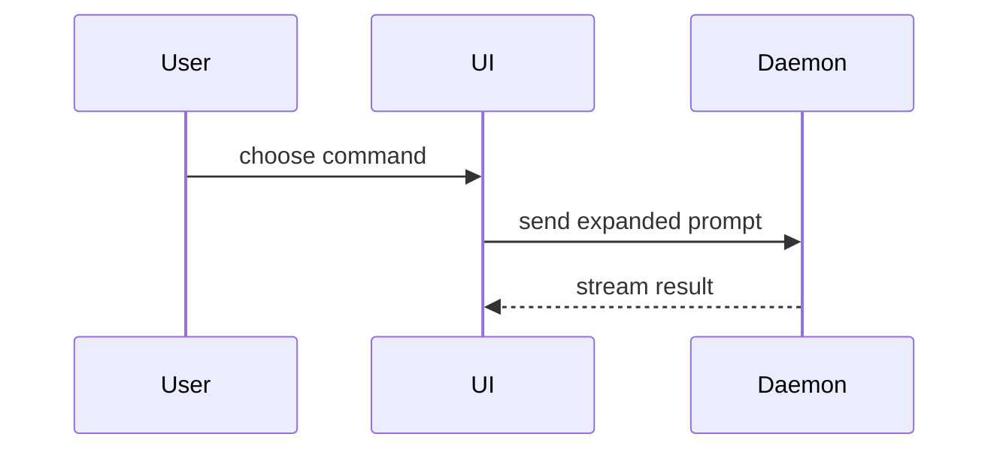

Use this template for writing the PR body:

```markdown
## Summary

<diagram, diff-sketch, or tree>

## Evidence

- **Before:** <screenshot/output/failing test run>
  **After:** <screenshot/output/passing test run>

## Merge Danger

**Door:** <one-way or two-way>

<optional: description>

**Blast Radius:** <one-word description>

<optional: potential ramifications of merge>
```

## Sections

Skip all preambles and keep prose brief. Use the user's domain language from `GLOSSARY.md`.

### Summary

Pick the smallest view that makes the key point clear. Choose the visualization type that best communicates the change's intent and impact.

#### Visualization Options

**Pseudocode** — Show logic or an algorithm step-by-step:

```text
on(save)
  if content is unchanged
    return cached result
  write new content
  return fresh result
```

**Call tree** — Show runtime control flow from entry point to side effects:

```text
submitForm
  createSession
    persistPrompt
    launchAgent
  navigateToSession
```

**Component tree** — Show UI structure with state and module boundaries:

```text
<SessionPage> (apps/example/src/routes/session.tsx)
  useSessionEvents()
  <SessionToolbar>
    <RunSkillButton> (packages/ui)
```

**File tree** — Show broad refactoring or file-responsibility boundaries:

```text
src/
├── commands/       # parses user actions
├── sessions/       # owns session state
└── transport/      # sends API requests
```

**Mermaid sequence diagram** — Show component interaction, data flow, or call stacks:



**Diff syntax** — When the surrounding shape already exists, show only the changed lines:

For a component change:

```diff
 <SessionPage>
   useSessionEvents()
   <SessionToolbar>
+    <RunSkillButton />
   <SessionTimeline>
+    <SkillResultCard />
```

For a file-layout change:

```diff
 src/
 ├── commands/
+│   └── show-me.ts       # expands the slash command
 ├── sessions/
-└── transport.ts
+└── transport/
+    ├── client.ts
+    └── stream.ts
```

For a call-tree or call-stack change:

```diff
 submitForm
   createSession
     persistPrompt
+    expandSkillMention
     launchAgent
-  navigateToSession
+  navigateToSession
+    subscribeToEvents
```

For a state or control-flow change:

```diff
 on(save)
-  write content
+  if content is unchanged
+    return cached result
+  write new content
+  invalidate cache
```

**Full block** — When most of the content is new, when omitted context would hide ownership or order, or when the user needs a copyable target shape:

```ts
function expandSkill(command: string): string {
  const skillName = command.slice(1);
  return `use the ${skillName} skill`;
}
```

#### Guidance

- Place each visual next to the short text it supports.
- Keep only the calls, files, props, states, and boundaries needed to answer the user's current question or resolve the discussion point.
- Use one or several visuals — it is unlikely you will use all of them.
- Use your judgement and don't overwhelm the user.
- Match the visualization type to the nature of the change: pseudocode for algorithms, call trees for control flow, component trees for UI, file trees for restructuring, diffs for incremental changes, full blocks for new logic.

### Evidence

Concrete evidence that the change works. Show a before and after.

**Screenshots** are S-tier — when the environment is set up for it and the change is visual.

**Execution-based evidence** is A-tier. Test results, console output. Show the exact test that now fails and passes, using pseudocode. Include command flags, error snippets, or output highlights.

### Merge Danger

Describe whether it's a one-way or two-way door. You can walk back through two-way doors, but not one-way doors. A PR that is cheap to roll back is lower risk. Changes that involve destructive actions or hard-to-reverse decisions are one-way doors.

The blast radius is the potential impact or scope of the changes introduced by this PR. Consider all possibilities. Examples include: layout shift, breakages for consumers, mobile responsiveness, performance degradation, API contract changes, data loss, security regressions, or build failures.

<optional: potential ramifications of merge>

- Cross-module ripple effects
- Consumer impact (breaking changes, deprecated APIs)
- Deployment pipeline impact
- Rollback complexity and cost
- Testing gaps introduced by the change
