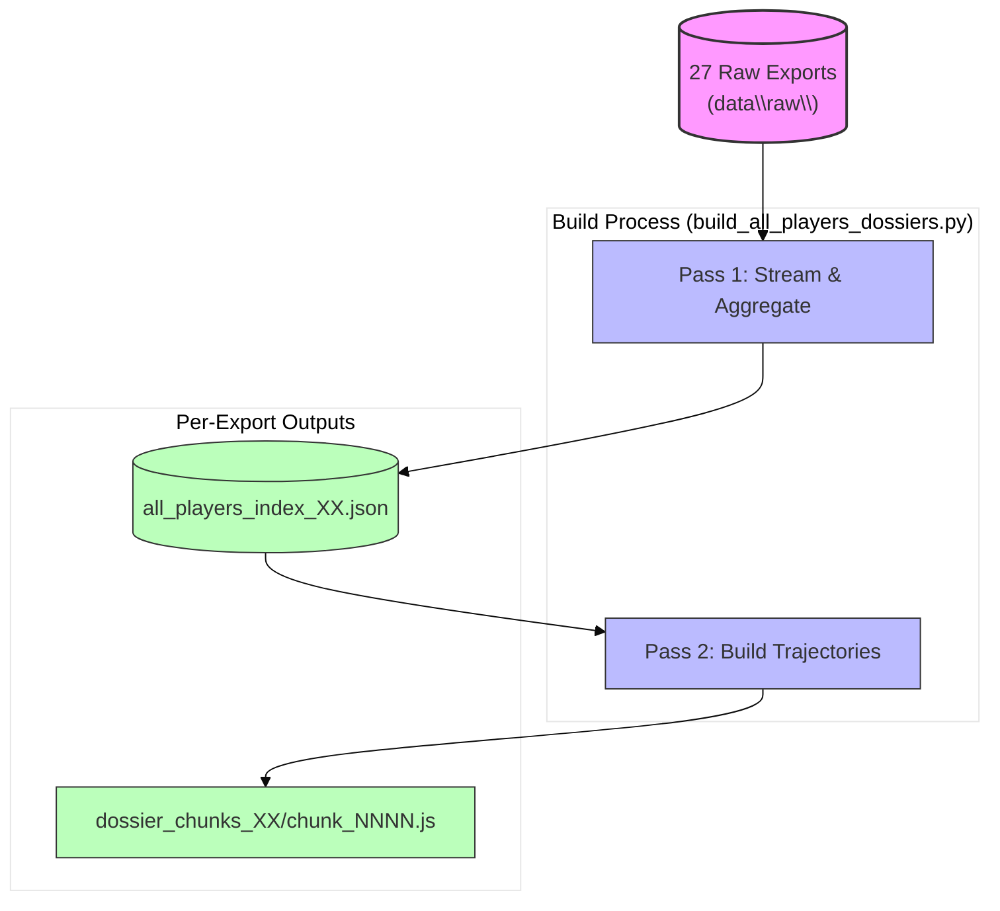
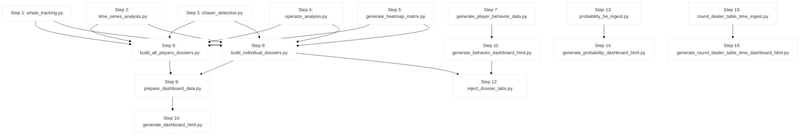

# Workspace Map — August 2026 {#workspace-map--august-2026}


> **Project**: Oriental Gaming Title — BI & Risk Intelligence Pipeline  
> **Scope**: Transaction-level analytics for **18.2M wagers** across **50,227 players** (27 exports, ~9.5 GB)  
> **Outputs**: Generated artifacts in `output/` (excluded from Git)  
> **Purpose**: Single source of truth for project structure, scripts, data flow, architecture, and recent changes


---
 
 > [!WARNING]
 > **CRITICAL DATA SAFETY WARNING**
 >
 > | Constraint | Details |
 > |------------|---------|
 > | **Dataset size** | ~17M rows (18,275,592 wagers) across 27 raw CSV exports |
 > | **File sizes** | Each export: 300–377 MB (~9.5 GB total) in `data\raw\` |
 > | **AI restriction** | **NEVER** open, read, scan, or process raw exports or any file > 100 KB |
 > | **Large files** | Listed by **NAME ONLY** in this document |
 > | **Inspection** | ONLY via Python scripts that print small summaries |
 >
 > <details>
 >
 > | Path | Description | Size |
 > |------|-------------|------|
 > | `data\raw\2026-10-0X-XX-XX-XX_EXPORT_CSV_XXXXX_XXX_0.csv` | 27 raw exports | ~9.5 GB total |
 > | `legacy output\all_players_dossiers.json` | Full merged dump | ~329 MB |
 > | `legacy output\all_players_index.json` | 50,227-player index | ~9.1 MB |
 > | `legacy output\dossier_chunks\chunk_0000.js ... chunk_0050.js` | 51 aggregate chunks | ~180 MB |
 > | `output\all_players_index_XX.json` | Per-export indexes | Varies |
 > | `output\dossier_chunks_XX\*\` | Per-export chunks | Varies |
 > | `output\bi_dashboard.html` | Embeds full player index | ~11 MB |
 > | `output\chaser_detection.csv` | | ~2.5 MB |
 > | `output\dashboard_data.json` | | ~145 KB |
 > | `output\individual_dossiers_data.json` | | ~267 KB |
 > | `output\player_behavior_data.json` | | ~221 KB |
 > | `output\game_probability_he_data.json` | | ~145 KB |
 >
 > </details>
 
 ---


---
 
 ## Table of Contents {#table-of-contents}
 
 - [0. Expected Columns & File Discovery](#expected-columns-file-discovery)
 - [1. Folder Tree Diagram](#folder-tree-diagram)
 - [2. Python Data Scripts & Parameters](#python-data-scripts-parameters)
 - [3. All-Players Dossier System — Architecture](#dossier-system-architecture)
 - [4. Data Flow Summary](#data-flow-summary)
 - [5. Currency Standardization](#currency-standardization)
 - [6. Master Pipeline Wrapper](#master-pipeline)
 - [7. Recent Changes](#recent-changes)
 - [8. Pipeline Location & Probability Cache](#pipeline-location-probability-cache)
 - [9. Probability & HE Console Trend Tabs](#probability-he-trend-tabs)
 - [10. Probability Console — All Games](#probability-all-games)
 - [11. Quick Nav + Threshold Breach Analytics](#quick-nav-breach-analytics)
 - [12. Sticky Header Filters + Breach Charts](#sticky-header-breach-charts)
 - [13. HE Trends Split Per Game](#he-trends-split-per-game)
 - [14. UI Cleanup: Conditional HE + Breach Charts](#conditional-he-breach-charts)
 - [15. Unified Dealer & Table Pace Console](#dealer-table-console)
 
 ---

## 0. Expected Columns & File Discovery {#expected-columns-file-discovery}


### Transaction Export Columns (`data/raw/*.csv`)

```
player_id, operator_name, game_name, currency, debit_amount, credit_amount,
winlose, formatted_debit_at, device_type, bet_id
```

### Supporting Data Files

| Type | Pattern | Notes |
|------|---------|-------|
| Currency snapshots | `data/probability/mnt_game_probability_he_YYYYMMDD.csv` | + `_manifest.json` |
| Dealer pace snapshots | `data/round_dealer_time/mnt_round_dealer_time_daily_YYYYMMDD.csv` | + `_manifest.json` |
| Table pace snapshots | `data/round_table_time/mnt_round_table_time_daily_YYYYMMDD.csv` | + `_manifest.json` |

### File Discovery per Pipeline Step

| Step(s) | Pattern | Scope |
|---------|---------|-------|
| 1–5 | `*.csv` in `data/raw/` | All matching files |
| 6 | `*EXPORT_CSV*.csv` in `data/raw/` | Each file independently |
| 7 | Random 5 `*EXPORT_CSV*.csv` | 5 sampled exports (`random.sample`) |
| 8 | First 5 exports + derived CSVs | First 5 exports only |
| 13 | `mnt_game_probability_he_YYYYMMDD.csv` | All daily snapshots |
| 15 | `round_dealer_time/` + `round_table_time/` | All available snapshots |

> **Adding exports**: Place new CSVs in `data/raw/`; steps 1–6 discover them on next run. Steps 7–8 remain limited to five exports. Skip guards use file modification times.


---

## 1. Folder Tree Diagram {#folder-tree-diagram}

```mermaid
%%{init: {'theme': 'base', 'themeVariables': { 'primaryColor': '#ffffff', 'primaryShapeFill': '#000000', 'fontFamily': 'sans-serif' }}}%%
graph TD
    A[August 2026/] --> B[.kilo/]
    A --> C[data/]
    A --> D[scripts/]
    A --> E[src/]
    A --> F[docs/]
    
    B --> G[.gitignore]
    B --> H[kilo.jsonc]
    
    C --> I[probability/]
    C --> J[round_dealer_time/]
    C --> K[round_table_time/]
    C --> L[raw/]
    
    I --> M[mnt_game_probability_he_YYYYMMDD.csv]
    I --> N[_manifest.json]
    
    J --> O[mnt_round_dealer_time_daily_YYYYMMDD.csv]
    J --> P[_manifest.json]
    
    K --> Q[mnt_round_table_time_daily_YYYYMMDD.csv]
    K --> R[_manifest.json]
    
    L --> S[2026-10-06-13-38-11_EXPORT_CSV_45625_808_0.csv]
    L --> T[2026-10-06-14-02-59_EXPORT_CSV_45627_085_0.csv]
    L --> U["... (25 more, 2026-10-06 through 2026-10-07) ..."]
    L --> V[2026-10-07-17-46-44_EXPORT_CSV_45680_721_0.csv]
    
    D --> W[generate_all_dashboards.py]
    D --> X[generate_chart.js]
    
    E --> Y[ingest/]
    
    Y --> Z[advanced_analysis.py]
    Y --> AA[whale_tracking.py]
    Y --> AB[time_series_analysis.py]
    Y --> AC[chaser_detection.py]
    Y --> AD[operator_analysis.py]
    Y --> AE[generate_heatmap_matrix.py]
    Y --> AF[build_all_players_dossiers.py]
    Y --> AG[generate_player_behavior_data.py]
    Y --> AH[build_individual_dossiers.py]
    Y --> AI[probability_he_ingest.py]
    Y --> AJ[currency_converter.py]
    Y --> AK[currency_cache.json]
    Y --> AL[inspect_behavior_metrics.py]
    Y --> AM[sample_behavior_check.py]
    Y --> AN[sample_profile_extractor.py]
    
    Y --> AP[dashboard/]
    
    AP --> AQ[prepare_dashboard_data.py]
    AP --> AR[generate_dashboard_html.py]
    AP --> AS[generate_behavior_dashboard_html.py]
    AP --> AT[generate_probability_dashboard_html.py]
    AP --> AU[inject_dossier_tabs.py]
    AP --> AV[regenerate_summary_csvs.py]
    AP --> AW[sections/]
    
    AW --> AX[nav_buttons.html]
    AW --> AY[tab_players.html]
    AW --> AZ[tab_operators.html]
    AW --> BA["slides.html"]
    AW --> BB["dossier.js"]
    
    A --> BC["workspace_map.md"]
```




<details>
<summary><strong>ASCII tree (legacy reference)</strong></summary>

```
August 2026/                                     (workspace root)
▲
▼•• .kilo/                                       (Kilo agent config)
▲   ▼•• .gitignore
▲   •• kilo.jsonc
▲
▼•• data/
    ▲   ▼•• probability/                                 (cached published game probability snapshots)
    ▲   ▲   ▼•• mnt_game_probability_he_YYYYMMDD.csv
    ▲   ▲   •• _manifest.json                           (scan range and unavailable dates)
    ▲   ▼•• round_dealer_time/                            (cached daily dealer pace snapshots)
    ▲   ▲   ▼•• mnt_round_dealer_time_daily_YYYYMMDD.csv
    ▲   ▲   •• _manifest.json
    ▲   ▼•• round_table_time/                             (cached daily table pace snapshots)
    ▲   ▲   ▼•• mnt_round_table_time_daily_YYYYMMDD.csv
    ▲   ▲   •• _manifest.json
    ▲   •• raw/                                         (27 raw CSV exports — NAME ONLY)
    ▲       ▼•• 2026-10-06-13-38-11_EXPORT_CSV_45625_808_0.csv
    ▲       ▼•• 2026-10-06-14-02-59_EXPORT_CSV_45627_085_0.csv
    ▲       ▼•• ... (25 more, 2026-10-06 through 2026-10-07) ...
    ▲       •• 2026-10-07-17-46-44_EXPORT_CSV_45680_721_0.csv
    ▲
|-- scripts/ (pipeline entry point and chart helper)
  |   |-- generate_all_dashboards.py (18-step master wrapper; section 6)
  |   `-- generate_chart.js
▼•• src/                                               (ALL Python data scripts)
▲   ▼•• ingest/                                        (raw-data ingestion & analysis)
▲   ▲   ▼•• advanced_analysis.py                       (LEGACY monolith: all 4 analyses in one process — superseded by the four split scripts below; kept for reference)
▲   ▲   ▼•• whale_tracking.py                          (step 1: Pareto top-20% by debit)
▲   ▲   ▼•• time_series_analysis.py                    (step 2: country peak-hour + hourly traffic)
▲   ▲   ▼•• chaser_detection.py                        (step 3: problem-gambling flags)
▲   ▲   ▼•• operator_analysis.py                       (step 4: operator profitability)
▲   ▲   ▼•• generate_heatmap_matrix.py                 (step 5: country x 24h bet matrix)
▲   ▲   ▼•• build_all_players_dossiers.py              (step 6: two-pass per-file index + trajectory chunks)
▲   ▲   ▼•• generate_player_behavior_data.py           (step 7: behavior telemetry)
▲   ▲   ▼•• build_individual_dossiers.py               (step 8: curated player/operator dossiers)
▲   ▲   ▼•• probability_he_ingest.py                   (step 13: fetch/backfill daily probability snapshots)
▲   ▲   ▼•• currency_converter.py                      (shared module: PHP conversion + country map)
▲   ▲   ▼•• currency_cache.json                        (cached historical FX rates, 30-day TTL)
▲   ▲   ▼•• inspect_behavior_metrics.py
▲   ▲   ▼•• sample_behavior_check.py
▲   ▲   •• sample_profile_extractor.py
▲   ▼•• dashboard/                                     (dashboard data prep & rendering)
▲   ▲   ▼•• prepare_dashboard_data.py                  (step 9: master BI payload)
▲   ▲   ▼•• generate_dashboard_html.py                 (step 10: MAIN BI console)
▲   ▲   ▼•• generate_behavior_dashboard_html.py        (step 11: behavior console)
▲   ▲   ▼•• generate_probability_dashboard_html.py     (step 14: probability & HE console)
▲   ▲   ▼•• inject_dossier_tabs.py                     (step 12: dossier tabs in behavior console)
▲   ▲   ▼•• regenerate_summary_csvs.py                 (helper: regenerates whale/chaser CSVs from unified index for consistency)
▲   ▲   •• sections/                                  (reusable HTML/JS components)
▲   ▲       ▼•• nav_buttons.html                       (nav buttons for tabs 6 & 7)
▲   ▲       ▼•• tab_players.html                       (Tab 6: ALL-player browser UI)
▲   ▲       ▼•• tab_operators.html                     (Tab 7: operator dossiers UI)
▲   ▲       ▼•• slides.html                            (presentation slides 7 & 8)
▲   ▲       •• dossier.js                             (dossier module: index + chunk loader)
▲   •• verify/                                        (inspection / verification)
▲       ▼•• analyze_retention_transactions.py
▲       ▼•• check_js_syntax.py
▲       ▼•• inspect_all_stats.py
▲       ▼•• inspect_operators.py
▲       ▼•• link_dashboards.py
▲       ▼•• update_generator.py
▲       ▼•• verify_behavior_dashboard.py
▲       •• verify_dashboard.py
▲
|-- output/ (generated artifacts)
  |   |-- dashboards/
  |   |   |-- dashboard-common.css   # Shared stylesheet (consistent look across all dashboards)
  |   |   |-- bi_dashboard.html
  |   |   |-- game_probability_dashboard.html
  |   |   |-- player_behavior_dashboard.html
  |   |   |-- round_dealer_table_time_dashboard.html
  |   |   `-- viewer.html
  |   |-- data/
  |   |   |-- all_players_index.json
  |   |   |-- all_players_index_00.json ... all_players_index_26.json
  |   |   |-- dashboard_data.json
  |   |   |-- game_probability_he_data.json
  |   |   |-- individual_dossiers_data.json
  |   |   |-- player_behavior_data.json
  |   |   `-- round_dealer_table_time_data.json
  |   |-- dossiers/
  |   |   `-- all_players_dossiers_00.json ... all_players_dossiers_26.json
  |   |-- chunks/
  |   |   |-- dossier_chunks/                            (aggregate chunks; chunk_0000.js ... chunk_0050.js)
  |   |   |-- dossier_chunks_00/ ... dossier_chunks_26/  (per-export chunks)
  |   |-- progress/
  |   |   `-- progress.json
  |   `-- reports/
  |       |-- chaser_detection.csv
  |       |-- country_hourly_heatmap.csv
  |       |-- hourly_traffic.csv
  |       |-- operator_performance.csv
  |       |-- time_series_analysis.csv
  |       `-- whale_analysis.csv
  |
▼•• docs/
▲   •• analysis_log.txt                               (run log)
▲
▼•• analysis_reports/                                (LEGACY/EMPTY — outputs moved to output/)
•• workspace_map.md                                (this file)
```

</details>


---

## 2. Python Data Scripts & Parameters {#python-data-scripts-parameters}


NOTE: None of these scripts use argparse or accept command-line arguments.
All paths are HARDCODED as module-level constants (FOLDER / REPORT_DIR / etc.).
To change the target, edit the constants at the top of each file.
Run with: py <script.py>   (the `python` alias is a Microsoft Store stub;
use the `py` launcher on this machine)

PROGRESS TRACKING: every ingest/dashboard script writes output\progress.json
via update_progress(stage, message, progress%, details) — {timestamp, stage,
message, progress, details}. The standalone viewer.html polls this file.

### A. RAW-DATA INGESTION & ANALYSIS  (src/ingest/ — read data\raw\)

| Script | Step | Purpose | Key Output | Skip-Guard |
|--------|------|---------|------------|------------|
| `whale_tracking.py` | 1 | Pareto top-20% by PHP debit; session estimation | `whale_analysis.csv` (20 rows) | CSV exists |
| `time_series_analysis.py` | 2 | Hourly/country bet buckets from timestamps | `time_series_analysis.csv`, `hourly_traffic.csv` | Both CSVs exist |
| `chaser_detection.py` | 3 | 3+ loss streak + 3× debit spike detection | `chaser_detection.csv` (25,263 rows) | CSV exists |
| `operator_analysis.py` | 4 | Operator ROI, GGR, volume, player counts | `operator_performance.csv` (750 rows) | CSV exists |
| `generate_heatmap_matrix.py` | 5 | Country × 24h bet-count matrix | `country_hourly_heatmap.csv` | CSV newer than raw exports |
| `build_all_players_dossiers.py` | 6 | Two-pass per-export index + trajectory chunks | `all_players_index_XX.json` (27), `dossier_chunks_XX/*.js` (51) | All indexes + chunks newer than exports |
| `generate_player_behavior_data.py` | 7 | Game stats, device split, bet brackets (5 sampled exports) | `player_behavior_data.json` | JSON newer than sampled exports |
| `build_individual_dossiers.py` | 8 | Curated 42 player + 35 operator forensics profiles | `individual_dossiers_data.json` | JSON newer than CSVs + first 5 exports |
| `probability_he_ingest.py` | 13 | Fetch/backfill daily probability/HE snapshots | `_manifest.json`, `game_probability_he_data.json` | Always runs (no skip-guard) |
| `currency_converter.py` | — | Shared: PHP conversion + country map (30-day cache) | Module only (no file output) | N/A |
| `inspect_behavior_metrics.py` / `sample_behavior_check.py` / `sample_profile_extractor.py` | — | Inspection utilities (stdout only) | stdout | N/A |
| `advanced_analysis.py` | — | LEGACY monolith (steps 1-4 in one pass) | Same as steps 1-4 | N/A (not in pipeline) |
### B. DASHBOARD DATA PREPARATION  (src/dashboard/ — read output/, write output/)

| Script | Step | Purpose | Key Output | Skip-Guard |
|--------|------|---------|------------|------------|
| `prepare_dashboard_data.py` | 9 | Assembles master BI payload from derived CSVs | `dashboard_data.json` | JSON newer than all derived CSVs |
| `generate_dashboard_html.py` | 10 | MAIN BI Console: embeds payload + full dossier system | `bi_dashboard.html` (~10.6 MB) | HTML newer than payload + indexes |
| `generate_behavior_dashboard_html.py` | 11 | Player Behavioral Intelligence Console | `player_behavior_dashboard.html` | HTML newer than behavior data |
| `inject_dossier_tabs.py` | 12 | Injects dossier tabs into behavior dashboard | `player_behavior_dashboard.html` (updated) | HTML newer than index + dossiers |
| `regenerate_summary_csvs.py` | — | Helper: regenerates whale/chaser CSVs from unified index | `whale_analysis.csv`, `chaser_detection.csv` | N/A (manual) |
| `generate_probability_dashboard_html.py` | 14 | Probability & HE Console with trend tabs + date range | `game_probability_dashboard.html` | HTML newer than payload + generator |

### C. INSPECTION / VERIFICATION / UTILITY  (src/verify/ — read output/)

| Script | Purpose | Key Output | Skip-Guard |
|--------|---------|------------|------------|
| `inspect_all_stats.py` | Prints summary stats | stdout | N/A |
| `inspect_operators.py` | Prints operator statistics | stdout | N/A |
| `analyze_retention_transactions.py` | Retention & bet-velocity rankings | stdout | N/A |
| `verify_dashboard.py` | Validates BI dashboard payload + JS | stdout (validation) | N/A |
| `verify_behavior_dashboard.py` | Validates behavior dashboard structure | stdout (validation) | N/A |
| `check_js_syntax.py` | JS brace/paren balance check | stdout (syntax check) | N/A |
| `link_dashboards.py` | Adds cross-dashboard nav link (modifies generator) | modifies `generate_dashboard_html.py` | N/A |
| `update_generator.py` | Lazy-init charts per tab (modifies generator) | modifies `generate_dashboard_html.py` | N/A |
| `fix_heatmap_colors.py` | Logarithmic heatmap color scale (modifies generator) | modifies `generate_dashboard_html.py` | N/A |

---

## 3. All-Players Dossier System — Architecture {#dossier-system-architecture}


GOAL: every one of the 50,227 players is browsable on the dashboard with
their FULL round-by-round balance trajectory.

BUILT BY: build_all_players_dossiers.py (step 6) — processes each export in
two streaming passes. It writes a per-export compact index after pass one,
then builds trajectories and writes that export's lazy-load chunks in pass
two. Time-ordered sequences bypass sorting. Per-export merged dumps are
optional and disabled by default.




<details>
<summary><strong>Embedded payload (bi_dashboard.html)</strong></summary>

• Embedded payload (bi_dashboard.html, `<script id="dossier-raw-data">`):
    { meta: {total_players: 50227, total_rows: 18275592, files: 27,
             chunk_size: 1000, total_chunks: 51},
      players: [50,227 compact index entries — id==array position==rank,
                sorted by total debit desc],
      operators: [35 detailed operator dossiers] }

</details>

<details>
<summary><strong>Compact player index entry</strong></summary>

• Compact player index entry (all_players_index_XX.json / DOSSIER.players[]):
    id (array index == rank), pid, country, arch, debit, winlose, bets,
    avg_bet, whale (bool), chaser (bool), op, spike.

</details>

<details>
<summary><strong>Trajectory chunk</strong></summary>

• Trajectory chunk (dossier_chunks_XX/chunk_NNNN.js,
  window.DOSSIER_CHUNK_NNNN; XX identifies the source export):
    Keyed by pid. Per player: balance_series[] (FULL trajectory),
    timestamps[] (Unix timestamps for each round), hours[24] (bet counts per hour), games[] ({game, bets, debit,
    win_rate_pct}), devices{Mobile, Desktop}, recent_rounds[]
    ({time, game, debit, credit, winlose, balance}).

</details>

<details>
<summary><strong>Tab 6 Player Dossiers (tab_players.html + dossier.js)</strong></summary>

• Tab 6 "Player Dossiers" (tab_players.html + dossier.js):
    - Hero shows total profiles + "Export All Players CSV" button
    - Search bar: player ID / country / archetype / operator
      (filterPlayerDossiers(), runs on every input event)
    - Tier filter dropdown: All Tiers / Whales / Chasers + all 13 archetypes
    - Country filter (populated from index at init) + 5 sort modes
      (debit, bets, pnl, spike, avg_bet)
    - Paginated card grid (60/120/240 per page) with WHALE/CHASER tags,
      country flag, archetype pill, and 4 KPIs (debit, net P&L, bets, avg bet)
    - Card click -> openPlayerDossier(id) (id is the INDEX ARRAY POSITION)
        -> chunkId = Math.floor(id / CHUNK_SIZE)
        -> loadDossierChunk(chunkId) lazy-loads
           dossier_chunks/chunk_NNNN.js via injected `<script>` tag
           (defines window.DOSSIER_CHUNK_NNNN keyed by player_id);
           concurrent requests for the same chunk share one callback queue
        -> renderDossierDetail() draws FULL balance_series, cumulative
           P&L curve (derived: balance[i] - balance[0]), hourly activity,
           game-mix pie, device split, recent-rounds forensics table
    - Charts are ECharts instances disposed on close/theme-toggle;
      trajectories load ON DEMAND (chunks total ~180 MB) so the page
      stays responsive; loaded chunks are cached in window.DOSSIER_CHUNK_*

</details>

<details>
<summary><strong>Tab 7 Operator Dossiers (tab_operators.html + dossier.js)</strong></summary>

• Tab 7 "Operator Dossiers" (tab_operators.html + dossier.js):
    Card grid of the 35 operator dossiers (GGR, hold margin, players,
    bets/player, volume, avg bet); openOperatorDossier(idx) renders games
    bar chart, hourly load, device mix and the top-players table.

</details>

<details>
<summary><strong>Entry points</strong></summary>

• Entry points — every "Open" button resolves ANY of the 50,227 players:
    - openPlayerDossierById(pid, contextTab): linear-finds pid in the index,
      switches to the players tab, opens the dossier. Called from the whale
      leaderboard, chaser registry, operator top-players table and the
      whale scatter chart click handler.
    - openOperatorDossierById(name): same pattern for operators, called from
      the operator bubble chart.
    - exportDossierCSV('players' | 'operators'): exports all index rows.

</details>

<details>
<summary><strong>Slide deck integration</strong></summary>

• Slide deck integration: renderDossierSlideCharts(idx) renders slide 7
  (archetype distribution bar + top-8 players by debit) and slide 8
  (top-8 operators by GGR + top-8 hold margins) from the embedded index.

</details>

<details>
<summary><strong>Theme handling</strong></summary>

• Theme handling: dossierTheme() reads getChartTheme() so charts follow the
  light/dark toggle; reinitAllCharts() disposes dossier charts and re-opens
  any dossier panel left open.

</details>

<details>
<summary><strong>Requirements</strong></summary>

• REQUIREMENT: dossier_chunks\ must sit next to bi_dashboard.html (and next
  to player_behavior_dashboard.html after step 12). Works when opened
  directly over file:// (script-tag loading is not CORS-blocked) or served
  over HTTP (python -m http.server).

</details>

<details>
<summary><strong>Interface note</strong></summary>

• INTERFACE NOTE: the existing dashboard generators and dossier.js still
  expect the aggregate all_players_index.json plus sibling dossier_chunks\
  layout documented above. The refactored step 6 now emits per-export
  all_players_index_XX.json and dossier_chunks_XX\ directories. An aggregate
  index/chunk assembly or dashboard loader update is required before these
  new per-export outputs can directly replace the existing dashboard inputs.

</details>

<details>
<summary><strong>Monthly Activity Calendar</strong></summary>

• Monthly Activity Calendar (NEW — added to Tab 6 dossier detail):
  - Interactive month calendar grid in player dossier panel showing active
    days (amber highlight + activity bar proportional to bet count)
  - Month navigation (prev/next buttons) with dynamic rendering
  - Click any active day → expands inline 24-hour breakdown (0:00–23:00)
    with per-hour bet counts; peak hour highlighted in red
  - Powered by new timestamps[] array in trajectory chunks (Unix seconds
    per round), added by build_all_players_dossiers.py Step 2
  - Functions: initDossierCalendar, renderDossierCalendar,
    dossierCalendarPrevMonth, dossierCalendarNextMonth, openDayDetail,
    closeDayDetail, buildDayTimestampMap
</details>


---

## 4. Data Flow Summary {#data-flow-summary}


```mermaid
%%{init: {'theme': 'base', 'themeVariables': { 'primaryColor': '#ffffff', 'primaryShapeFill': '#000000', 'fontFamily': 'sans-serif' }}}%%
flowchart TD
    %% Main Ingestion Flow
    raw_exports[("27 Raw Exports (data/raw/)")]

    subgraph ingestion_scripts[7 Ingestion Scripts]
        whale[whale_tracking.py]
        ts[time_series_analysis.py]
        chase[chaser_detection.py]
        op[operator_analysis.py]
        heatmap[generate_heatmap_matrix.py]
        behavior_ingest[generate_player_behavior_data.py]
        dossier_build[build_all_players_dossiers.py]
    end

    subgraph derived_csvs["Derived CSVs & JSON"]
        whale_csv[whale_analysis.csv]
        ts_csv[time_series_analysis.csv]
        hourly_csv[hourly_traffic.csv]
        chase_csv[chaser_detection.csv]
        op_csv[operator_performance.csv]
        heatmap_csv[country_hourly_heatmap.csv]
        player_behavior_data[player_behavior_data.json]
        all_players_index[all_players_index_XX.json]
        all_players_index_agg["all_players_index.json (aggregate)"]
        chunks_js[dossier_chunks_XX/*.js]
        individual_dossiers[individual_dossiers_data.json]
    end

    raw_exports --> whale
    raw_exports --> ts
    raw_exports --> chase
    raw_exports --> op
    raw_exports --> heatmap
    raw_exports --> behavior_ingest
    raw_exports --> dossier_build

    whale --> whale_csv
    ts --> ts_csv
    ts --> hourly_csv
    chase --> chase_csv
    op --> op_csv
    heatmap --> heatmap_csv
    behavior_ingest --> player_behavior_data
    dossier_build --> all_players_index
    dossier_build --> chunks_js
    all_players_index --> all_players_index_agg

    raw_exports -.->|first 5 exports + CSVs| individual_dossiers
    whale_csv -.-> individual_dossiers
    chase_csv -.-> individual_dossiers
    op_csv -.-> individual_dossiers

    subgraph prepare_dashboard["Dashboard Data Preparation"]
        prepare[prepare_dashboard_data.py]
        dashboard_data[dashboard_data.json]
    end

    whale_csv --> prepare
    ts_csv --> prepare
    hourly_csv --> prepare
    chase_csv --> prepare
    op_csv --> prepare
    heatmap_csv --> prepare
    prepare --> dashboard_data

    subgraph generate_dashboard_html["Main BI Console Generation"]
        gen_bi[generate_dashboard_html.py]
        sections["sections/* (nav, tabs, slides, dossier.js)"]
        bi_dashboard["bi_dashboard.html (Oriental Gaming Title BI & Risk Intelligence Console)"]
    end

    dashboard_data --> gen_bi
    all_players_index_agg --> gen_bi
    individual_dossiers --> gen_bi
    sections --> gen_bi
    gen_bi --> bi_dashboard

    %% Parallel Behavior Flow
    subgraph BehaviorFlow["Behavior Dashboard Flow"]
        gen_behavior[generate_behavior_dashboard_html.py]
        player_behavior_dashboard[player_behavior_dashboard.html]
        inject_dossier_tabs[inject_dossier_tabs.py]
        dossier_enabled_behavior[(dossier-enabled player_behavior_dashboard.html)]
    end

    player_behavior_data --> gen_behavior
    gen_behavior --> player_behavior_dashboard
    player_behavior_dashboard --> inject_dossier_tabs
    all_players_index_agg --> inject_dossier_tabs
    individual_dossiers --> inject_dossier_tabs
    inject_dossier_tabs --> dossier_enabled_behavior

    %% Probability & HE Flow
    subgraph ProbabilityFlow["Probability & HE Console Flow"]
        mnt_game_probability_he[(mnt_game_probability_he_ YYYYMMDD.csv (data/probability/))]
        probability_he_ingest[probability_he_ingest.py]
        game_probability_he_data[game_probability_he_data.json]
        generate_probability_dashboard_html[generate_probability_dashboard_html.py]
        game_probability_dashboard[game_probability_dashboard.html]
    end

    mnt_game_probability_he --> probability_he_ingest
    probability_he_ingest --> game_probability_he_data
    game_probability_he_data --> generate_probability_dashboard_html
    generate_probability_dashboard_html --> game_probability_dashboard

    %% Runtime Note
    runtime_note[["RUNTIME (browser): bi_dashboard.html embeds index + operator dossiers; player card click lazy-loads chunk_NNNN.js from dossier_chunks/ ; 4 dashboards share dashboard-common.css"]]

    bi_dashboard -.-> runtime_note
    dossier_enabled_behavior -.-> runtime_note
    game_probability_dashboard -.-> runtime_note

    classDef raw fill:#f9f,stroke:#333,stroke-width:2px;
    classDef script fill:#bbf,stroke:#333,stroke-width:1px;
    classDef derived fill:#bfb,stroke:#333,stroke-width:1px;
    classDef output fill:#ff9,stroke:#333,stroke-width:2px;
    classDef runtime fill:#f99,stroke:#333,stroke-width:2px,stroke-dasharray: 5 5;

    class raw_exports,mnt_game_probability_he raw;
    class whale,ts,chase,op,heatmap,behavior_ingest,dossier_build,prepare,gen_bi,gen_behavior,inject_dossier_tabs,probability_he_ingest,generate_probability_dashboard_html script;
    class whale_csv,ts_csv,hourly_csv,chase_csv,op_csv,heatmap_csv,player_behavior_data,all_players_index,all_players_index_agg,chunks_js,individual_dossiers,dashboard_data,game_probability_he_data derived;
    class bi_dashboard,player_behavior_dashboard,dossier_enabled_behavior,game_probability_dashboard output;
    class runtime_note runtime;
```

RUNTIME (browser): `bi_dashboard.html` embeds the index + operator dossiers; each player card click lazy-loads its `chunk_NNNN.js` from `dossier_chunks\`. The four dashboard HTML files link to one another via shared `dashboard-common.css` stylesheet.


---

## 5. Currency Standardization {#currency-standardization}

All monetary amounts in the raw data are in various currencies. To enable accurate cross-player and cross-country analysis, **ALL amounts are converted to PHP (Philippine Peso)** using date-relative historical exchange rates.

### 5.1 Currencies in Raw Data (19 Total)

| Currency | Country/Region | Notes |
|----------|----------------|-------|
| CNY | China | Chinese Yuan |
| IDR | Indonesia | Indonesian Rupiah |
| VND | Vietnam | Vietnamese Dong (unsupported by API, uses base rate) |
| KRW | South Korea | South Korean Won |
| JPY | Japan | Japanese Yen |
| THB | Thailand | Thai Baht |
| USD | United States | US Dollar |
| SGD | Singapore | Singapore Dollar |
| HKD | Hong Kong | Hong Kong Dollar |
| TWD | Taiwan | New Taiwan Dollar (unsupported by API, uses base rate) |
| MYR | Malaysia | Malaysian Ringgit |
| INR | India | Indian Rupee |
| MMK | Myanmar | Myanmar Kyat (unsupported by API, uses base rate) |
| NPR | Nepal | Nepalese Rupee (unsupported by API, uses base rate) |
| BDT | Bangladesh | Bangladeshi Taka (unsupported by API, uses base rate) |
| TRY | Turkey | Turkish Lira |
| USDT | Crypto | Tether (treated as USD peg) |
| IDRK | Indonesia (alt) | Alternate IDR code variant |
| VNDK | Vietnam (alt) | Alternate VND code variant |

### 5.2 currency_converter.py Module Reference

| Property | Detail |
|----------|--------|
| **cache file** | `src/ingest/currency_cache.json` (persisted JSON) |
| **TTL** | 30 days (rates older than 30 days are re-fetched) |
| **convert_to_php** | `convert_to_php(amount, currency, date_str)` — date-specific rate from frankfurter.app, memory + disk cached |
| **get_country / CURRENCY_COUNTRY** | `get_country(currency)` / `CURRENCY_COUNTRY` dict — currency to country map, imported by every ingest script for consistent attribution |
| **rate fallback** | Uses `BASE_RATES` when API unavailable or currency unsupported by frankfurter.app |
| **unsupported currencies** | VND, TWD, MMK, NPR, BDT — never supported by API; always use base fallback rates |

### 5.3 Script Currency Conversion Usage (8 Scripts)

| Script | Conversion Usage |
|--------|------------------|
| `whale_tracking.py` | Whale debit totals converted to PHP for Pareto ranking |
| `time_series_analysis.py` | Country mapping via `CURRENCY_COUNTRY` for hourly/country buckets |
| `chaser_detection.py` | Loss streaks and spike multipliers computed in PHP |
| `operator_analysis.py` | Operator ROI and GGR calculated on PHP-normalized amounts |
| `build_all_players_dossiers.py` | All player trajectories, balance series, P&L in PHP |
| `generate_player_behavior_data.py` | Game stats, hourly timing, bet brackets use PHP conversion |
| `generate_heatmap_matrix.py` | Country mapping via `get_country()` for country x 24h matrix |
| `build_individual_dossiers.py` | Player/operator profiles, balances, P&L in PHP |

### 5.4 Output Impact

**All derived CSVs, JSON files, and dashboards reflect PHP-normalized values.** Whale thresholds, chaser spike multipliers, operator ROI, and player archetypes are computed on PHP-standardized amounts. This ensures consistent cross-currency analysis across the entire BI pipeline.

---

## 6. Master Pipeline Wrapper {#master-pipeline}

Runs the ENTIRE Oriental Gaming Title data pipeline in strict dependency order
as standalone processes (each script uses hardcoded absolute paths, so no
argv is passed; each writes output\progress.json). Invoke with:
    py scripts\generate_all_dashboards.py

### 6.1 Dependency Graph



### 6.2 Pipeline Steps Table

| Step | Script | Output | Skip-Guard Condition |
|------|--------|--------|---------------------|
| 1 | whale_tracking.py | whale_analysis.csv | Output CSV exists and non-empty |
| 2 | time_series_analysis.py | time_series_analysis.csv + hourly_traffic.csv | Both output CSVs exist and non-empty |
| 3 | chaser_detection.py | chaser_detection.csv | Output CSV exists and non-empty |
| 4 | operator_analysis.py | operator_performance.csv | Output CSV exists and non-empty |
| 5 | generate_heatmap_matrix.py | country_hourly_heatmap.csv | CSV newer than all raw exports |
| 6 | build_all_players_dossiers.py | all_players_index_XX.json + dossier_chunks_XX/chunk_NNNN.js | All 27 per-export indexes + chunk sets newer than source exports |
| 7 | generate_player_behavior_data.py | player_behavior_data.json | JSON newer than sampled 5 raw exports |
| 8 | build_individual_dossiers.py | individual_dossiers_data.json | JSON newer than whale/chaser/operator CSVs and first 5 exports |
| 9 | prepare_dashboard_data.py | dashboard_data.json | JSON newer than all derived CSVs |
| 10 | generate_dashboard_html.py | bi_dashboard.html | HTML newer than dashboard_data.json, individual_dossiers_data.json, and all per-export indexes |
| 11 | generate_behavior_dashboard_html.py | player_behavior_dashboard.html | HTML newer than player_behavior_data.json |
| 12 | inject_dossier_tabs.py | player_behavior_dashboard.html (updated) | HTML (post-injection) newer than all_players_index.json and individual_dossiers_data.json |
| 13 | probability_he_ingest.py | game_probability_he_data.json | Always runs (no skip-guard) |
| 14 | generate_probability_dashboard_html.py | game_probability_dashboard.html | HTML newer than game_probability_he_data.json and generator |
| 15 | round_dealer_table_time_ingest.py | round_dealer_table_time_data.json | JSON newer than generator script |
| 16 | generate_round_dealer_table_time_dashboard_html.py | round_dealer_table_time_dashboard.html | HTML newer than data payload and generator |

### 6.3 Script-to-Output Dependency Graph

```mermaid
%%{init: {'theme': 'base', 'themeVariables': { 'primaryColor': '#ffffff', 'primaryShapeFill': '#000000', 'fontFamily': 'sans-serif' }}}%%
flowchart TD
    %% Scripts grouped by layer
    subgraph Ingestion["Ingestion"]
        S1[whale_tracking.py]
        S2[time_series_analysis.py]
        S3[chaser_detection.py]
        S4[operator_analysis.py]
        S5[generate_heatmap_matrix.py]
        S6[build_all_players_dossiers.py]
        S7[generate_player_behavior_data.py]
        S8[build_individual_dossiers.py]
        S13[probability_he_ingest.py]
        S15[round_dealer_table_time_ingest.py]
    end

    subgraph Prep["Dashboard Prep"]
        S9[prepare_dashboard_data.py]
    end

    subgraph Generators["Dashboard Generators"]
        S10[generate_dashboard_html.py]
        S11[generate_behavior_dashboard_html.py]
        S12[inject_dossier_tabs.py]
        S14[generate_probability_dashboard_html.py]
        S16[generate_round_dealer_table_time_dashboard_html.py]
    end

    subgraph Outputs["Output Artifacts"]
        O1[whale_analysis.csv]
        O2[time_series_analysis.csv]
        O3[hourly_traffic.csv]
        O4[chaser_detection.csv]
        O5[operator_performance.csv]
        O6[country_hourly_heatmap.csv]
        O7[player_behavior_data.json]
        O8[all_players_index_XX.json]
        O9[dossier_chunks_XX/*.js]
        O10[individual_dossiers_data.json]
        O11[game_probability_he_data.json]
        O12[round_dealer_table_time_data.json]
        O13[dashboard_data.json]
        O14[bi_dashboard.html]
        O15[player_behavior_dashboard.html]
        O16[game_probability_dashboard.html]
        O17[round_dealer_table_time_dashboard.html]
    end

    %% Edges: Script -> Output
    S1 --> O1
    S2 --> O2
    S2 --> O3
    S3 --> O4
    S4 --> O5
    S5 --> O6
    S7 --> O7
    S6 --> O8
    S6 --> O9
    S8 --> O10
    S13 --> O11
    S15 --> O12

    %% Cross-dependencies
    O1 --> S9
    O2 --> S9
    O3 --> S9
    O4 --> S9
    O5 --> S9
    O6 --> S9
    S9 --> O13

    O13 --> S10
    O8 --> S10
    O10 --> S10
    S10 --> O14

    O7 --> S11
    S11 --> O15
    O15 --> S12
    O8 --> S12
    O10 --> S12
    S12 --> O15

    O11 --> S14
    S14 --> O16

    O12 --> S16
    S16 --> O17

    classDef script fill:#bbf,stroke:#333;
    classDef prep fill:#ff9,stroke:#333;
    classDef gen fill:#bff,stroke:#333;
    classDef out fill:#bfb,stroke:#333;

    class S1,S2,S3,S4,S5,S6,S7,S8,S13,S15 script;
    class S9 prep;
    class S10,S11,S12,S14,S16 gen;
    class O1,O2,O3,O4,O5,O6,O7,O8,O9,O10,O11,O12,O13,O14,O15,O16,O17 out;
```



### 6.4 Features

- **ProgressBar** (bar + % + ETA) rendered to stdout as steps complete
- **Skip-guards**: steps are skipped when outputs exist and are newer than their dependencies; the probability ingest (step 13) always runs to find new snapshots
- **Missing script handling**: missing scripts are reported as `[SKIP]` and counted as failures
- **Exit codes**: 0 = all steps OK, 1 = one or more failures (listed at the end)

### 6.5 Why Steps 6 and 8 Are NOT Redundant

- **Step 6 (build_all_players_dossiers.py)**: Processes each of the 27 exports separately → per-export compact indexes and lazy-loadable trajectory chunks, with file-level resume guards and no full history retained during index extraction. The optional merged dump is off unless `BUILD_DOSSIER_MONOLITH=1`.
- **Step 8 (build_individual_dossiers.py)**: Reads only the first 5 exports + the derived CSVs (steps 1–4) → a curated set of 42 players and 35 operators with aggregated forensics (game mix, hourly load, device split, top players). No full trajectory. Powers the operator-dossier "Open" buttons and detailed player/operator profiles.
- **Both are required**: `generate_dashboard_html.py` (step 10) embeds BOTH payloads.

### 6.6 Dependency Notes

- Steps 6 and 8 both consume the step 1–4 CSVs, so steps 1–4 must run first.
- Step 10 reads the outputs of steps 6, 8, and 9, so those must precede it.
- Step 12 needs the step 8 output (individual_dossiers_data.json) and the step 11 HTML (player_behavior_dashboard.html).
- Step 9 reads all derived CSVs from steps 1–5.
- Step 6 produces per-export indexes and chunks; step 8 produces curated dossiers.
- Step 13 (probability ingest) always runs and has no skip-guard.

---

## 7. Recent Changes {#recent-changes}

Fixed data consistency and completeness issues identified during dashboard audit (2026-10-09):

<details>
<summary><strong>1. FIXED: merge_per_file_dossiers()</strong> — Merged multi-file player trajectories (19,045 players)</summary>

1. FIXED: merge_per_file_dossiers() in generate_dashboard_html.py
   - Previously: Only used first chunk's detail for each player (dropped multi-file trajectories)
   - Now: Concatenates trajectories from all source chunks chronologically by timestamps
   - Result: All 19,045 multi-file players now have merged balance_series, timestamps, games, hours, recent_rounds
</details>

<details>
<summary><strong>2. REGENERATED: Unified index and chunks</strong> — Correct totals for 50,227 players; Monthly Activity Calendar fixed</summary>

2. REGENERATED: Unified index and chunks (all_players_index.json + dossier_chunks/)
   - Correct totals for all 50,227 players
   - Player ZR_62633509_15105215938: 799 bets across Aug 20 & 28 now in merged chunk
   - Monthly Activity Calendar now shows all dates from merged timestamps
</details>

<details>
<summary><strong>3. CREATED: regenerate_summary_csvs.py</strong> — Regenerates whale/chaser CSVs from unified index for consistency</summary>

3. CREATED: src/dashboard/regenerate_summary_csvs.py
   - Regenerates whale_analysis.csv and chaser_detection.csv from unified index
   - Ensures summary tabs (Whales/Chasers) use same data source as Player Dossiers tab
   - Computes sessions from timestamps (30-min gap), spike multipliers from balance_series
</details>

<details>
<summary><strong>4. FIXED: Whale/Chaser data consistency</strong> — 0 mismatches (was 20/20 whales, 10/10 chasers)</summary>

4. FIXED: Whale/Chaser data consistency (0 mismatches)
   - Before: 20/20 whales and 10/10 chasers mismatched (different aggregation pipelines)
   - After: All CSV totals match unified index exactly
</details>

<details>
<summary><strong>5. FIXED: whale_analysis.csv limited to top 20</strong> — VIP Whales tab now shows exactly 20 players</summary>

5. FIXED: whale_analysis.csv limited to top 20
   - VIP Whales tab now shows exactly 20 players (was showing all 50,227)
</details>

<details>
<summary><strong>6. ADDED: Whale Group Dossier in Tab 1</strong> — Aggregate KPIs, geo breakdown, archetypes, 5 insights</summary>

6. ADDED: Whale Group Dossier in Tab 1 (VIP Whales)
   - Aggregate KPI strip: Total Debit (7.27B), Total Wagers (123,924), Avg Session (0.74h), Countries (4), Casino Concentration (42.3%)
   - Geographic Composition breakdown with country flags and debit percentages
   - Behavioral Archetypes: Lightning/Bot (sub-3min), Burst Whale, Sustained Grinder
   - 5 Key Group Insights: dominant profile, geographic concentration, top individual, volume velocity, session brevity
</details>

<details>
<summary><strong>7. ADDED: Chaser Group Dossier in Tab 2</strong> — Risk tiers, tilt analysis, 5 risk insights</summary>

7. ADDED: Chaser Group Dossier in Tab 2 (Risk & Chasers)
   - Aggregate KPI strip: Total Debit (22.61B), Total Flagged (25,263), Net Losers (69.1%), Net P&L (-334.6M), Peak Spike (7,500x)
   - Risk Tier Distribution: Extreme (≥1000x: 5), Critical (100-999x: 240), High (20-99x: 1,850), Moderate (5-19x: 6,522), Low (<5x: 16,646)
   - Tilt Threshold Analysis: L1-L10 loss streak breakdown with L3 highlighted as PEAK trigger (11.2%)
   - 5 Key Risk Insights: loss-streak tipping point, financial destructiveness, extreme risk cohort, streak escalation, net winner anomaly
</details>

<details>
<summary><strong>8. FIXED: "Loss Thresholds: The 'Tilt' Curve" chart</strong> — Streak≥3 filter, live denominator, correct markPoint</summary>

8. FIXED: "Loss Thresholds: The 'Tilt' Curve" chart (Tab 2, initChaserTiltChart)
    - CHART SCOPE: now filters loss_streak_distribution to streak >= 3 before slicing; bars start at L3
    - BUG 1 (stale denominator): total_chasers now counted from CSV at build time (25,263 vs hardcoded 11,978)
    - BUG 2 (markPoint on wrong bar): Threshold Point now at L3 bar with dynamic label
    - Replaced all hardcoded "11,978" labels with live DATA.chasers-driven elements
</details>

<details>
<summary><strong>9. FIXED: "24-Hour Outcome Volume" chart</strong> — Removed stacking; independent win/loss/push lines</summary>

9. FIXED: "24-Hour Outcome Volume: Wins, Losses & Pushes" chart (Tab 1, initTimingCharts)
     - BUG: All three series used `stack: 'Total'`, showing cumulative sums instead of true hourly counts
     - FIX: Removed `stack: 'Total'`; each outcome displays actual hourly count independently with width:2 and areaStyle
     - Files: generate_behavior_dashboard_html.py:1029-1033, output/player_behavior_dashboard.html:1013-1015
</details>

<details>
<summary><strong>10. ADDED: Player Archetype Legend card in Tab 6</strong> — 13 archetypes with colors, descriptions, assignment rules</summary>

10. ADDED: "Player Archetype Legend" card in Tab 6 (All Player Dossiers)
     - Purpose: explains every player label (VIP Whale, Low Chaser, etc.) so users understand assignment
     - 13-item grid with ARCHETYPE_COLORS and one-line descriptions from ARCHETYPE_DESC
     - Footnote: assignment rule = Spike Multiplier + total volume; Chasers escalate after losses (spike ≥ 3x), Whales = top 0.4% by debit (~384M); dual flags possible
     - Files: tab_players.html, dossier.js, inject_dossier_tabs.py, bi_dashboard.html, player_behavior_dashboard.html
</details>

<details>
<summary><strong>11. ADDED: Clickable archetype toggle filter</strong> — Legend cards as buttons with AND-combined filtering</summary>

11. ADDED: Clickable archetype toggle filter on the legend cards
     - Each legend card is a button (cursor-pointer, Enter/Space, aria-pressed); toggles archetype into a Set
     - `filterPlayerDossiers()` gained `matchArch` clause: AND-combined with search, tier, country filters
     - Selected cards highlighted (filled background, double-ring border); count badge + Clear button in header
     - Files: dossier.js (toggleArchetypeFilter, clearArchetypeFilters, renderArchetypeLegend), tab_players.html, inject_dossier_tabs.py, both dashboards


---

## 8. Pipeline Location & Probability Cache {#pipeline-location-probability-cache}


1. PIPELINE LOCATION
   - The 14-step master wrapper is scripts/generate_all_dashboards.py (not the
     workspace root). scripts/generate_chart.js is a helper.
   - Pipeline scripts write live progress to output/progress.json.

2. PROBABILITY / HOUSE-EDGE SNAPSHOT CACHE
   - data/probability/ contains daily published CSV snapshots from
     2025-01-31 through 2026-10-11; the cache was scanned through 2026-10-11
     on 2026-10-12.
   - data/probability/_manifest.json records unavailable dates. The current
     missing interval is 2026-01-13 through 2026-01-29.
   - Pipeline steps 13 and 14 refresh output/game_probability_he_data.json
     and output/game_probability_dashboard.html from this cache/feed.
   - Cached CSV snapshots are each under 100 KB; inspect only as needed.


---


---

## 9. Probability & HE Console Trend Tabs {#probability-he-trend-tabs}


Consolidated the two selected-game trend charts on
output/dashboards/game_probability_dashboard.html (generated by
src/dashboard/generate_probability_dashboard_html.py, pipeline step 14) into a
single tabbed interface with a date-range selector. The three other charts
(Average actual vs expected HE by game, Probability vs expected probability and
threshold, Latest bet-place relationship) are unchanged.

1. TABBED TREND CONTAINER
   - The two former standalone articles ("HE trend for selected game",
     "Probability and threshold trend") were replaced by ONE
     <article class="card chart-card wide" id="trendPanel"> that holds a
     .trend-tabs button row plus two .trend-pane panels (pane-heTrend,
     pane-probTrend). Only the active pane is displayed; the other is
     display:none.
   - Pattern intentionally mirrors bi_dashboard.html: .tab-pane sections
     toggled by a nav row, active state expressed as a class on both the pane
     and its button (.trend-pane.active / .trend-tab-btn.active), with a
     fadeIn animation and ECharts resize() after the switch so the newly
     revealed chart gets real dimensions.
   - switchTrendTab('he'|'prob') removes .active from all .trend-pane and
     .trend-tab-btn elements, adds .active to the target pane/button, syncs
     aria-selected for accessibility, then calls
     charts.heTrend/ProbTrend.resize() in a 50 ms timeout.
   - ECharts instance registration is unchanged: chartIds still contains
     ['heCompare','probCompare','heTrend','probTrend','relationship'], so the
     existing instances and the other two charts are untouched. Charts are
     created up-front (hidden panes are dimensioned 0 but are resized on first
     reveal).

2. DATE RANGE SELECTOR
   - New <input type="date" id="startDate"> and <input type="date" id="endDate">
     sit in the .filters row next to the existing Trend game / Trend window
     selects, plus a #resetDateRange button.
   - initDateRangeBounds() sets both inputs' min/max from
     meta.billing_date_min / meta.billing_date_max (with a series-data
     fallback) so users cannot pick dates outside the cached feed range.
   - getDateRange() reads the two inputs; inDateRange(day) tests each ISO date
     string (series day values and input values are both YYYY-MM-DD, so plain
     string comparison is correct).
   - selectedTrendValues() applies the date range in addition to the existing
     period-window cutoff, so BOTH trend tabs filter live on 'change' of either
     date input. Empty inputs mean "no bound" on that side.
   - The date range ALSO drives the two cross-game comparison charts:
     "Average actual vs expected HE by game" (heCompare) and "Probability vs
     expected probability and threshold" (probCompare). comparisonValues()
     re-averages DATA.series_he / series_expected_he /
     series_actual_probability / series_expected_probability / series_threshold
     per game over the filtered days. When NO range is set it returns the
     payload's precomputed game_types[].mean_* values verbatim, so the default
     (unfiltered) view is byte-identical to before this change. Each card's
     #heCompareNote / #probCompareNote caption appends "· start to end" while a
     range is active.
   - The Game type summary table keeps the precomputed full-history means and
     is intentionally NOT range-filtered.
   - resetDateRange() clears both inputs and re-renders everything.

3. VERIFICATION
   - JS syntax validated (node --check).
   - Functional smoke test with a stubbed DOM/ECharts: 36/36 checks pass —
     all 5 ECharts instances still initialise, default tab state is correct,
     tab switching toggles panes/buttons/aria and resizes the target chart,
     date bounds come from meta, date range filters the trend series
     (single-day and start-only cases), the Comparison charts reproduce the
     precomputed means when no range is set and re-average the filtered series
     when one is (with live caption updates), reset restores the precomputed
     values, and renderTrends()/render() run without error.

Note: the generator writes output/game_probability_dashboard.html; the copy in
output/dashboards/ is the sibling-linked console that users open (its nav links
point at bi_dashboard.html / player_behavior_dashboard.html). Both were
regenerated/synced.


---


---

## 2026-10-13 — Probability Console Shows All Games at Once## 10. Probability Console — All Games {#probability-all-games}


output\dashboards\game_probability_dashboard.html (generator:
src\dashboard\generate_probability_dashboard_html.py, pipeline step 14) no
longer relies on the "Trend game" dropdown — every game type is displayed
simultaneously, with a new combined aggregate section on top.

1. REMOVED: <select id="gameFilter"> and its label from the .filters row. The
   hero h2 now reads "Every game at a glance: combined trends and per-game
   detail". The .filters row keeps Trend window (#periodFilter), Start date,
   End date and the Reset range button.

2. ADDED: "Combined Summary — all games" section at the top of the main grid:
   a wide header card (#combinedNote shows pooled row/bet-place counts, pooled
   breach rate and the active range) plus two ECharts instances —
   #combinedHe (overall HE trend: pooled daily mean actual vs expected HE) and
   #combinedProb (overall probability and threshold trend) — both built from
   DATA.daily (per-day cross-game means). renderCombinedSummary() drives them.

3. REPLACED: the tabbed trend panel (id="trendPanel", .trend-tabs /
   .trend-pane, switchTrendTab) is gone. Its two per-selected-game charts are
   superseded by the per-game charts below; the unused trend-tab CSS was
   removed.

4. ADDED: buildGameSections() — a JS loop over DATA.game_types that injects one
   <article class="card chart-card wide" id-free> per game into
   <div class="game-sections" id="gameSections"> (CSS display:contents so the
   articles participate directly in the 2-column .grid). Each section contains:
   - A dedicated <table> inside <div class="table-wrap">: a bold
     .table-total row ("<GAME> — all bet places") with timeframe-filtered
     game-level means followed by one row per bet place from
     DATA.bet_places (full-history pooled means; the caption notes this).
   - Two .chart-card charts inside a nested .grid: "HE trend — <GAME>"
     (#gameHe-<i>) and "Probability and threshold trend — <GAME>"
     (#gameProb-<i>), series style matching the old trend charts (time axis,
     inside+slider dataZoom, smooth lines, dashed expected, dotted threshold).
   ECharts instances are registered in the gameCharts array.

5. GLOBAL TIMEFRAME: inTimeframe(day) = date range ∩ trend window
   (#periodFilter, default 90 days). It now applies simultaneously to the
   Combined Summary charts, every per-game table (game row) and every per-game
   chart; changing #periodFilter, #startDate or #endDate re-renders all of
   them via render(). timeframeSeries()/timeframeMean() recompute the
   game-level metrics from the per-game series over the visible days. The two
   cross-game comparison charts (heCompare/probCompare) keep their existing
   date-range behaviour with precomputed mean_* fallback, and the "Game type
   summary" table keeps the precomputed full-history means.

6. VERIFICATION: node --check on the inline script; stubbed DOM/ECharts smoke
   test — 39/39 checks pass (21 chart instances: 5 static + 16 per-game; 8
   per-game tables with 1 + bet-place rows each; window switch widens series
   and updates table days; date range filters the combined charts and updates
   the captions; reset restores full history; relationship scatter groups match
   the valid latest-day rows).


---


---

## 2026-10-13 — Quick Nav + Threshold Breach Analytics## 11. Quick Nav + Threshold Breach Analytics {#quick-nav-breach-analytics}


Follow-up to section 10 on output\dashboards\game_probability_dashboard.html
(plus a supporting payload change from
src\ingest\probability_he_ingest.py, pipeline step 13).

1. STICKY QUICK NAVIGATION (inside the existing sticky <header>):
   <nav class="quick-nav" id="quickNav"> wraps to its own row (flex-basis:100%)
   with a top separator, so it stays pinned while scrolling. buildQuickNav()
   fills it from a "Jump to" label + links: #combinedPanel (Combined Summary),
   #breachAnalytics (Threshold Breach Analytics), one link per game, and
   #gameSummary (Game type summary). Each per-game article now carries a unique
   anchor id (id="game-BACCARAT", …) assigned by uniqueGameAnchor() —
   slugify() uppercases and hyphenates the name and a numeric suffix resolves
   the CLASSIC DT / Classic DT casing alias collision. html has
   scroll-behavior:smooth and article[id]{scroll-margin-top:140px} so jumps
   clear the sticky header.

2. THRESHOLD BREACH ANALYTICS: new <article class="card chart-card wide"
   id="breachAnalytics"> directly below the Combined Summary block, holding a
   nested .grid with:
   - #breachCalendar — ECharts calendar coordinate system + heatmap series of
     daily breach counts (DATA.daily[].breaches) over the visible range, with a
     horizontal visualMap scaled to the worst day in view.
   - #breachByDate — stacked bar chart, one stacked series per game type over
     billing-date categories, from the new series_breach_count payload field.
   - Two .table-wrap tables: "Number of times threshold exceeded by game type"
     (#breachByGameRows: breaches in view, share, days in view, breaches/day,
     full-history breaches and breach %) and "… by betting area"
     (#breachByBetPlaceRows: all 111 bet places with in-view and full-history
     breaches from the new bet_place_breaches payload field).

3. PAYLOAD SUPPORT (probability_he_ingest.py): the per-(date, game) breach
   COUNTS were computed internally but only the percentage was published.
   Added series_breach_count {game: [[date, count], …]} (dense) and
   bet_place_breaches {"GAME|bet_place": [[date, count], …]} (sparse, breach
   days only). Payload grew 821 KB -> ~1.07 MB. Verified: per-game daily counts
   sum exactly to game_types[].breaches and each bet-place series sums to
   bet_places[].breaches (61 of 111 bet places ever breach).

4. GLOBAL TIMEFRAME: renderBreachAnalytics() is part of render(), so the
   calendar, stacked bar and both tables recalculate whenever #periodFilter,
   #startDate or #endDate changes (inTimeframe = date range ∩ trend window);
   #breachNote reports totals, days in view and the peak day.

5. VERIFICATION: node --check; stubbed DOM/ECharts smoke test — 38/38 checks
   pass (23 chart instances: 7 static + 16 per-game; 11 quick-nav links all
   resolving to existing anchors; unique game ids incl. the DT alias pair;
   calendar/stacked-bar series and table totals reconcile with the payload for
   the 90-day window, "all" history, an August start date and reset).


---


---

## 2026-10-13 — Sticky Header Filters + Breach Charts## 12. Sticky Header Filters + Breach Charts {#sticky-header-breach-charts}


Follow-up to sections 10-11 on
output\dashboards\game_probability_dashboard.html (generator:
src\dashboard\generate_probability_dashboard_html.py; no payload change).

1. FILTERS MOVED INTO THE STICKY HEADER
   - The .filters container (Trend window #periodFilter, Start date
     #startDate, End date #endDate, Reset range #resetDateRange) moved out of
     the hero and inside <header>, where header .filters { flex-basis: 100% }
     gives it its own separated row between the dashboard links and the
     quick-nav. The header now stacks: title + BI/Behavior links, time filters,
     jump links — all pinned while scrolling. The hero keeps only the h2 +
     intro paragraph. article[id]{scroll-margin-top} raised 140px -> 200px so
     anchor jumps still clear the taller header.
   - #periodFilter gained <option value="7">Latest 7 days</option> as the first
     choice; 90 days remains the default. inTimeframe() already derives the
     cutoff from Number(days), so 7 works everywhere with no logic change.

2. BREACH TABLES REPLACED WITH ECHARTS
   - "Number of times threshold exceeded by betting area" -> #breachByPlace:
     horizontal bar chart (yAxis category, inverse so the largest sits on top)
     listing all 111 "GAME · bet_place" areas with value labels, an in+slider
     dataZoom on the yAxis, and a height that scales at 18px per bar capped at
     1100px (set inline, then resize()). Tooltip shows in-view and full-history
     counts.
   - "Number of times threshold exceeded by game type" -> #breachByGame:
     vertical bar chart sorted descending, per-game colors, top value labels,
     and an axis tooltip with share of in-view breaches, days in view,
     breaches/day and full-history totals.
   - The old .table-wrap tables (#breachByGameRows / #breachByBetPlaceRows)
     were removed entirely; chartIds now registers breachByGame and
     breachByPlace (9 static + 16 per-game = 25 instances).

3. LAYOUT REORDER FOR HIGH-PRIORITY METRICS
   - Top of the main grid: #combinedPanel header, then "Probability vs
     expected probability and threshold" (#probCompare) — immediately below
     the global KPIs — then #combinedHe, #combinedProb and #heCompare.
   - #breachAnalytics follows, its first item now the betting-area chart
     (#breachByPlace), then the calendar (#breachCalendar), the stacked
     by-date bars (#breachByDate) and the by-game chart (#breachByGame).
   - Per-game sections, latest-day scatter and the full-history Game type
     summary table keep their positions after the breach section.

4. VERIFICATION: node --check; stubbed DOM/ECharts smoke test — 28/28 checks
   pass (25 chart instances; filters + listeners inside the header; 7-day
   option present with 90 still default; both breach charts horizontal/vertical
   as specified, sorted, capped height, slider zoom; chart totals reconcile
   with daily[].breaches for the 7-day, 90-day, custom-start and reset cases;
   previous per-game/quick-nav regressions still green).


---


---

## 2026-10-13 — HE Trends Split Per Game## 13. HE Trends Split Per Game {#he-trends-split-per-game}


Follow-up to section 12 on output\dashboards\game_probability_dashboard.html
(generator: src\dashboard\generate_probability_dashboard_html.py; no payload
change). Requested because the pooled HE line chart mixed all games on one
pair of axes.

1. REMOVED: the combined "Overall HE trend — all games" chart — its article,
   the 'combinedHe' entry in chartIds and the charts.combinedHe.setOption block
   inside renderCombinedSummary(). No game-agnostic HE line chart remains; the
   dashboard no longer plots multiple game types on one HE trend axis.

2. RENAMED: the per-game charts generated by buildGameSections() now read
   "<GAME> - HE Trend" (e.g. "BACCARAT - HE Trend") and
   "<GAME> - Probability and threshold trend", so each standalone chart is
   self-labelling inside its own game section. Series names stay "Actual HE" /
   "Expected HE" (dashed) and "Actual probability" / "Expected probability" /
   "Threshold" (dotted). Per-game HE trend charts still follow the global
   timeframe (trend window ∩ date range) via timeframeSeries().

3. KEPT: heCompare ("Average actual vs expected HE by game") — it is a grouped
   BAR comparison, not a trend line chart, so it does not overlap lines; it is
   now .wide to fill the Combined Summary row left open by the removed chart.
   Combined Summary order: header, probCompare (probability comparison),
   combinedProb (pooled probability trend), heCompare — followed by Threshold
   Breach Analytics.

4. VERIFICATION: node --check; stubbed DOM/ECharts smoke test — 23/23 checks
   pass (24 chart instances: 8 static + 16 per-game; combinedHe never
   initialised and no setOption sent to it; every game section contains its own
   labelled "<GAME> - HE Trend" chart with exactly 2 series plotting only that
   game's series; 90-day / "all" / start-date / reset cases all re-filter the
   per-game HE charts; breach and quick-nav regressions still green).


---


---

## 2026-10-13 — UI Cleanup: Conditional HE + Breach Charts## 14. UI Cleanup: Conditional HE + Breach Charts {#conditional-he-breach-charts}


Follow-up to section 13 on output\dashboards\game_probability_dashboard.html
(generator: src\dashboard\generate_probability_dashboard_html.py; no payload
change).

1. REMOVED: every per-game "Probability and threshold trend" chart — the second
   card of each game section (gameProb-<i> div, ECharts instance, setOption and
   the nested .grid that paired the two cards). Each game section is now a
   standard single-view container: heading, meta caption, table, then one
   full-width .chart-card.single "<GAME> - HE Trend" chart. (The old tabbed
   trend panel from section 9 was already gone; nothing tab-related remains.)
   The Combined Summary charts probCompare and combinedProb are untouched.

2. CONDITIONAL HE TREND CHARTS: buildGameSections() computes
   gameHeAvailable[index] = game.mean_actual_he != null AND series_he has at
   least one non-null point. Games without HE data get NO ECharts instance
   (gameCharts[i].he === null) and their wrapper <article
   id="gameHeCard-<i>"> is generated with style="display:none". At render time
   renderGameSections() re-evaluates the window-filtered points: the wrapper is
   shown/hidden and setOption is skipped whenever the visible timeframe has no
   HE points (e.g. SICBO, whose HE series only spans 2025-01-25..2025-05-03,
   disappears under the default 90-day window and returns under "all" dates).
   allCharts() filters out the null instances so resize stays safe.

3. CONDITIONAL TABLE COLUMNS: the per-game <thead> is now built dynamically
   (gameHead-<i>). Games without usable HE data drop the "Actual HE",
   "Expected HE" and "HE delta" columns from the header AND from every row
   (6-cell rows instead of 9) — BULL BULL (mean_actual_he null, 0/599 series
   points, no HE model published) renders that way, and its meta caption notes
   "no house-edge model published for this game".

4. ZERO-BREACH FILTERING: the two breach charts now filter before hitting
   ECharts — byGame keeps only games with in-view breaches > 0 and byPlace only
   betting areas with in-view breaches > 0 (axes, bars, labels, tooltips and
   the dynamic byPlace height all derive from the filtered arrays). Under the
   default 90-day window that is 5 games; under "all" dates 7 games (the
   zero-breach "Classic DT" alias drops out) and 61 of 111 betting areas.
   Tooltips still show full-history totals for the listed entries.

5. VERIFICATION: node --check; stubbed DOM/ECharts smoke test — 30/30 checks
   pass (15 chart instances: 8 static + 7 per-game HE, BULL BULL skipped;
   wrapper visibility matches in-window HE points incl. the SICBO hide/reveal
   cases; BULL BULL 6-cell rows and 6-column head vs ROULETTE's 9; breach
   charts exclude zero-breach games/areas across 7-day, 90-day and "all"
   windows, stay sorted descending, and the byPlace height matches the filtered
   count).


---


---

## 2026-10-15 — Unified Dealer & Table Pace Console## 15. Unified Dealer & Table Pace Console {#dealer-table-console}


The master dashboard pipeline now uses one combined pace data source and one
dashboard generator:

  - Pipeline step 15: src\ingest\round_dealer_table_time_ingest.py writes
    output\round_dealer_table_time_data.json from the dealer and table daily
    snapshots cached in data\round_dealer_time\ and data\round_table_time\.
  - Pipeline step 16: src\dashboard\generate_round_dealer_table_time_dashboard_html.py
    writes output\dashboards\round_dealer_table_time_dashboard.html.
  - The console payload maps each observation to BILLING_DATE, GAME_TYPE,
    DEALER, TABLE_NO, AVG_TIMEDIFF and STD_TIMEDIFF. Dealer and table source
    rows remain distinct; the source does not provide dealer-table pairings.
  - A GAME_TYPE selector scopes every KPI, chart and table to one game.
    Dashboard features include selected-game dealer trends and baseline,
    slow-dealer watchlist, efficiency matrix, pace extremes and one forensics
    table. ECharts use getChartTheme() styling and resize on layout changes.
  - The standalone round_dealer_time_dashboard.html and
    round_table_time_dashboard.html outputs, plus their two dashboard HTML
    generator scripts, have been retired. The standalone ingest scripts remain
    in src\ingest\ but are not part of the master pipeline.

  Data sources:
    - Dealer snapshots: https://ogp.oss-ap-southeast-1.aliyuncs.com/share/
      mnt_round_dealer_time_daily_YYYYMMDD.csv  (cached in data/round_dealer_time/)
    - Table snapshots: https://ogp.oss-ap-southeast-1.aliyuncs.com/share/
      mnt_round_table_time_daily_YYYYMMDD.csv  (cached in data/round_table_time/)
    - CSV columns: BILLING_DATE, GAME_TYPE, DEALER|TABLE_NO, AVG_TIMEDIFF,
      STD_TIMEDIFF (verified 2026-10-12)

  Console features:
    - KPI strip: Global Average Pace, Selected Game Baseline, Average Std Dev,
      Active Fleet (dealer/table counts)
    - Watchlist: Slow Dealers — dealers slower than the selected game's baseline
      by >= 1.50 s or in its slowest 10%, horizontal bar chart with color-coded
      severity and click-to-open dealer dossier
    - Watchlist: High-Variance Shifts — rows where dealer's daily STD_TIMEDIFF
      exceeds 200% of its 30-day moving average, horizontal bar chart (top 30,
      dataZoom slider for the rest, dashed 2.0x threshold line); clicking a bar
      opens that dealer's dossier. Also rendered per-dealer inside each dealer
      dossier panel (top 20 of that dealer's shifts).
      (consistency) for all dealer+table profiles in the selected game
    - Dealer Speed Over Time — daily baseline line plus up to five fastest and
      five slowest dealer trend lines, with dataZoom and a dashed golden markLine
      labeled "Baseline Avg: X.XX s"
    - Top / Bottom 10 Dealer & Table Profiles — horizontal bar chart ranked by
      average time, fastest in green, slowest in red
    - Day-of-the-Week Volatility — highest/lowest bars highlighted in red/green
      for both AVG_TIMEDIFF and STD_TIMEDIFF series, with a centered color
      legend naming the extreme day and value for each series
    - Individualized Dealer Dossier — card grid of dealers with KPIs and a
      per-dealer trend chart (lazy-loaded on click). Filters: baseline
      (above/below), min days (14/30/60+), week-over-week (faster/slower/no-data),
      high-variance shifts (has / none). Clicking a card opens the dealer dossier
      panel with context-switching penalty and per-dealer high-variance shifts
    - Forensics table — full telemetry listing with billing date, game type,
      dealer, table no, avg time and std dev; paginated 100/page
    - Jump to interface — sticky header nav with links to all sections
      (KPIs, Day-of-Week Volatility, both watchlists, Dealer Speed Over Time,
      Efficiency Matrix, Top/Bottom 10 Profiles, Individualized Dealer Dossier,
      Forensics Table)

</details>
<style>
mermaid {
    color: #ffffff !important;
    background-color: #000000 !important;
}
</style>
EOF

