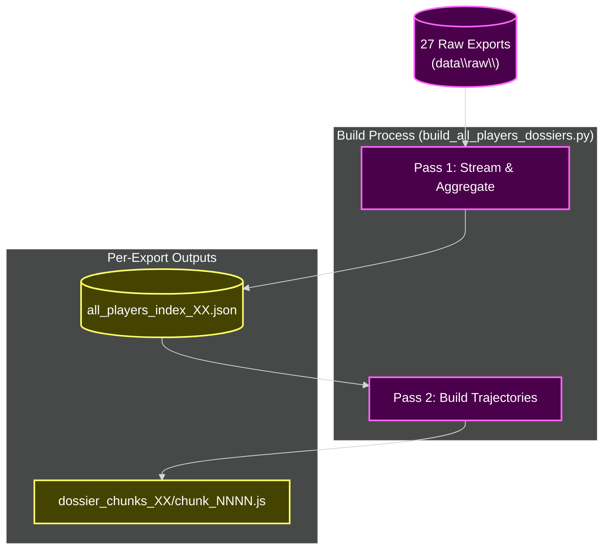
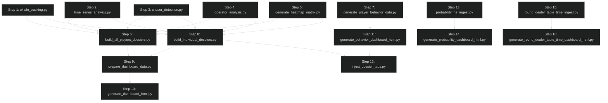

# Workspace Map — August 2026 {#workspace-map--august-2026}


> **Project**: Oriental Gaming Title — BI & Risk Intelligence Pipeline  
> **Scope**: Transaction-level analytics for **18.2M wagers** across **50,227 players** (27 exports, ~9.5 GB)  
> **Outputs**: Generated artifacts in `output/` (excluded from Git)  
> **Purpose**: Single source of truth for project structure, scripts, data flow, architecture, and recent changes


---
 
 > [!WARNING]
 > **CRITICAL DATA SAFETY WARNING**
 >
 > | Constraint | Details |
 > |------------|---------|
 > | **Dataset size** | ~17M rows (18,275,592 wagers) across 27 raw CSV exports |
 > | **File sizes** | Each export: 300–377 MB (~9.5 GB total) in `data\raw\` |
 > | **AI restriction** | **NEVER** open, read, scan, or process raw exports or any file > 100 KB |
 > | **Large files** | Listed by **NAME ONLY** in this document |
 > | **Inspection** | ONLY via Python scripts that print small summaries |
 >
 > <details>
 >
 > | Path | Description | Size |
 > |------|-------------|------|
 > | `data\raw\2026-10-0X-XX-XX-XX_EXPORT_CSV_XXXXX_XXX_0.csv` | 27 raw exports | ~9.5 GB total |
 > | `legacy output\all_players_dossiers.json` | Full merged dump | ~329 MB |
 > | `legacy output\all_players_index.json` | 50,227-player index | ~9.1 MB |
 > | `legacy output\dossier_chunks\chunk_0000.js ... chunk_0050.js` | 51 aggregate chunks | ~180 MB |
 > | `output\all_players_index_XX.json` | Per-export indexes | Varies |
 > | `output\dossier_chunks_XX\*\` | Per-export chunks | Varies |
 > | `output\bi_dashboard.html` | Embeds full player index | ~11 MB |
 > | `output\chaser_detection.csv` | | ~2.5 MB |
 > | `output\dashboard_data.json` | | ~145 KB |
 > | `output\individual_dossiers_data.json` | | ~267 KB |
 > | `output\player_behavior_data.json` | | ~221 KB |
 > | `output\game_probability_he_data.json` | | ~145 KB |
 >
 > </details>
 
 ---


---
 
 ## Table of Contents {#table-of-contents}
 
 - [0. Expected Columns & File Discovery](#expected-columns-file-discovery)
 - [1. Folder Tree Diagram](#folder-tree-diagram)
 - [2. Python Data Scripts & Parameters](#python-data-scripts-parameters)
 - [3. All-Players Dossier System — Architecture](#dossier-system-architecture)
 - [4. Data Flow Summary](#data-flow-summary)
 - [5. Currency Standardization](#currency-standardization)
 - [6. Master Pipeline Wrapper](#master-pipeline)
 - [7. Recent Changes](#recent-changes)
 - [8. Pipeline Location & Probability Cache](#pipeline-location-probability-cache)
 - [9. Probability & HE Console Trend Tabs](#probability-he-trend-tabs)
 - [10. Probability Console — All Games](#probability-all-games)
 - [11. Quick Nav + Threshold Breach Analytics](#quick-nav-breach-analytics)
 - [12. Sticky Header Filters + Breach Charts](#sticky-header-breach-charts)
 - [13. HE Trends Split Per Game](#he-trends-split-per-game)
 - [14. UI Cleanup: Conditional HE + Breach Charts](#conditional-he-breach-charts)
 - [15. Unified Dealer & Table Pace Console](#dealer-table-console)
 
 ---

## 0. Expected Columns & File Discovery {#expected-columns-file-discovery}


### Transaction Export Columns (`data/raw/*.csv`)

```
player_id, operator_name, game_name, currency, debit_amount, credit_amount,
winlose, formatted_debit_at, device_type, bet_id
```

### Supporting Data Files

| Type | Pattern | Notes |
|------|---------|-------|
| Currency snapshots | `data/probability/mnt_game_probability_he_YYYYMMDD.csv` | + `_manifest.json` |
| Dealer pace snapshots | `data/round_dealer_time/mnt_round_dealer_time_daily_YYYYMMDD.csv` | + `_manifest.json` |
| Table pace snapshots | `data/round_table_time/mnt_round_table_time_daily_YYYYMMDD.csv` | + `_manifest.json` |

### File Discovery per Pipeline Step

| Step(s) | Pattern | Scope |
|---------|---------|-------|
| 1–5 | `*.csv` in `data/raw/` | All matching files |
| 6 | `*EXPORT_CSV*.csv` in `data/raw/` | Each file independently |
| 7 | Random 5 `*EXPORT_CSV*.csv` | 5 sampled exports (`random.sample`) |
| 8 | First 5 exports + derived CSVs | First 5 exports only |
| 13 | `mnt_game_probability_he_YYYYMMDD.csv` | All daily snapshots |
| 15 | `round_dealer_time/` + `round_table_time/` | All available snapshots |

> **Adding exports**: Place new CSVs in `data/raw/`; steps 1–6 discover them on next run. Steps 7–8 remain limited to five exports. Skip guards use file modification times.


---

## 1. Folder Tree Diagram {#folder-tree-diagram}

```mermaid
%%{init: {'theme': 'dark', 'themeVariables': { 'fontFamily': 'sans-serif' }}}%%
graph TD
    A[August 2026/] --> B[.kilo/]
    A --> C[data/]
    A --> D[scripts/]
    A --> E[src/]
    A --> F[docs/]
    
    B --> G[.gitignore]
    B --> H[kilo.jsonc]
    
    C --> I[probability/]
    C --> J[round_dealer_time/]
    C --> K[round_table_time/]
    C --> L[raw/]
    
    I --> M[mnt_game_probability_he_YYYYMMDD.csv]
    I --> N[_manifest.json]
    
    J --> O[mnt_round_dealer_time_daily_YYYYMMDD.csv]
    J --> P[_manifest.json]
    
    K --> Q[mnt_round_table_time_daily_YYYYMMDD.csv]
    K --> R[_manifest.json]
    
    L --> S[2026-10-06-13-38-11_EXPORT_CSV_45625_808_0.csv]
    L --> T[2026-10-06-14-02-59_EXPORT_CSV_45627_085_0.csv]
    L --> U["... (25 more, 2026-10-06 through 2026-10-07) ..."]
    L --> V[2026-10-07-17-46-44_EXPORT_CSV_45680_721_0.csv]
    
    D --> W[generate_all_dashboards.py]
    D --> X[generate_chart.js]
    
    E --> Y[ingest/]
    
    Y --> Z[advanced_analysis.py]
    Y --> AA[whale_tracking.py]
    Y --> AB[time_series_analysis.py]
    Y --> AC[chaser_detection.py]
    Y --> AD[operator_analysis.py]
    Y --> AE[generate_heatmap_matrix.py]
    Y --> AF[build_all_players_dossiers.py]
    Y --> AG[generate_player_behavior_data.py]
    Y --> AH[build_individual_dossiers.py]
    Y --> AI[probability_he_ingest.py]
    Y --> AJ[currency_converter.py]
    Y --> AK[currency_cache.json]
    Y --> AL[inspect_behavior_metrics.py]
    Y --> AM[sample_behavior_check.py]
    Y --> AN[sample_profile_extractor.py]
    
    Y --> AP[dashboard/]
    
    AP --> AQ[prepare_dashboard_data.py]
    AP --> AR[generate_dashboard_html.py]
    AP --> AS[generate_behavior_dashboard_html.py]
    AP --> AT[generate_probability_dashboard_html.py]
    AP --> AU[inject_dossier_tabs.py]
    AP --> AV[regenerate_summary_csvs.py]
    AP --> AW[sections/]
    
    AW --> AX[nav_buttons.html]
    AW --> AY[tab_players.html]
    AW --> AZ[tab_operators.html]
    AW --> BA["slides.html"]
    AW --> BB["dossier.js"]
    
    A --> BC["workspace_map.md"]
```





---

## 2. Python Data Scripts & Parameters {#python-data-scripts-parameters}


NOTE: None of these scripts use argparse or accept command-line arguments.
All paths are HARDCODED as module-level constants (FOLDER / REPORT_DIR / etc.).
To change the target, edit the constants at the top of each file.
Run with: py <script.py>   (the `python` alias is a Microsoft Store stub;
use the `py` launcher on this machine)

PROGRESS TRACKING: every ingest/dashboard script writes output\progress.json
via update_progress(stage, message, progress%, details) — {timestamp, stage,
message, progress, details}. The standalone viewer.html polls this file.

### A. RAW-DATA INGESTION & ANALYSIS  (src/ingest/ — read data\raw\)

| Script | Step | Purpose | Key Output | Skip-Guard |
|--------|------|---------|------------|------------|
| `whale_tracking.py` | 1 | Pareto top-20% by PHP debit; session estimation | `whale_analysis.csv` (20 rows) | CSV exists |
| `time_series_analysis.py` | 2 | Hourly/country bet buckets from timestamps | `time_series_analysis.csv`, `hourly_traffic.csv` | Both CSVs exist |
| `chaser_detection.py` | 3 | 3+ loss streak + 3× debit spike detection | `chaser_detection.csv` (25,263 rows) | CSV exists |
| `operator_analysis.py` | 4 | Operator ROI, GGR, volume, player counts | `operator_performance.csv` (750 rows) | CSV exists |
| `generate_heatmap_matrix.py` | 5 | Country × 24h bet-count matrix | `country_hourly_heatmap.csv` | CSV newer than raw exports |
| `build_all_players_dossiers.py` | 6 | Two-pass per-export index + trajectory chunks | `all_players_index_XX.json` (27), `dossier_chunks_XX/*.js` (51) | All indexes + chunks newer than exports |
| `generate_player_behavior_data.py` | 7 | Game stats, device split, bet brackets (5 sampled exports) | `player_behavior_data.json` | JSON newer than sampled exports |
| `build_individual_dossiers.py` | 8 | Curated 42 player + 35 operator forensics profiles | `individual_dossiers_data.json` | JSON newer than CSVs + first 5 exports |
| `probability_he_ingest.py` | 13 | Fetch/backfill daily probability/HE snapshots | `_manifest.json`, `game_probability_he_data.json` | Always runs (no skip-guard) |
| `currency_converter.py` | — | Shared: PHP conversion + country map (30-day cache) | Module only (no file output) | N/A |
| `inspect_behavior_metrics.py` / `sample_behavior_check.py` / `sample_profile_extractor.py` | — | Inspection utilities (stdout only) | stdout | N/A |
| `advanced_analysis.py` | — | LEGACY monolith (steps 1-4 in one pass) | Same as steps 1-4 | N/A (not in pipeline) |
### B. DASHBOARD DATA PREPARATION  (src/dashboard/ — read output/, write output/)

| Script | Step | Purpose | Key Output | Skip-Guard |
|--------|------|---------|------------|------------|
| `prepare_dashboard_data.py` | 9 | Assembles master BI payload from derived CSVs | `dashboard_data.json` | JSON newer than all derived CSVs |
| `generate_dashboard_html.py` | 10 | MAIN BI Console: embeds payload + full dossier system | `bi_dashboard.html` (~10.6 MB) | HTML newer than payload + indexes |
| `generate_behavior_dashboard_html.py` | 11 | Player Behavioral Intelligence Console | `player_behavior_dashboard.html` | HTML newer than behavior data |
| `inject_dossier_tabs.py` | 12 | Injects dossier tabs into behavior dashboard | `player_behavior_dashboard.html` (updated) | HTML newer than index + dossiers |
| `regenerate_summary_csvs.py` | — | Helper: regenerates whale/chaser CSVs from unified index | `whale_analysis.csv`, `chaser_detection.csv` | N/A (manual) |
| `generate_probability_dashboard_html.py` | 14 | Probability & HE Console with trend tabs + date range | `game_probability_dashboard.html` | HTML newer than payload + generator |

### C. INSPECTION / VERIFICATION / UTILITY  (src/verify/ — read output/)

| Script | Purpose | Key Output | Skip-Guard |
|--------|---------|------------|------------|
| `inspect_all_stats.py` | Prints summary stats | stdout | N/A |
| `inspect_operators.py` | Prints operator statistics | stdout | N/A |
| `analyze_retention_transactions.py` | Retention & bet-velocity rankings | stdout | N/A |
| `verify_dashboard.py` | Validates BI dashboard payload + JS | stdout (validation) | N/A |
| `verify_behavior_dashboard.py` | Validates behavior dashboard structure | stdout (validation) | N/A |
| `check_js_syntax.py` | JS brace/paren balance check | stdout (syntax check) | N/A |
| `link_dashboards.py` | Adds cross-dashboard nav link (modifies generator) | modifies `generate_dashboard_html.py` | N/A |
| `update_generator.py` | Lazy-init charts per tab (modifies generator) | modifies `generate_dashboard_html.py` | N/A |
| `fix_heatmap_colors.py` | Logarithmic heatmap color scale (modifies generator) | modifies `generate_dashboard_html.py` | N/A |

---

## 3. All-Players Dossier System — Architecture {#dossier-system-architecture}


GOAL: every one of the 50,227 players is browsable on the dashboard with
their FULL round-by-round balance trajectory.

BUILT BY: build_all_players_dossiers.py (step 6) — processes each export in
two streaming passes. It writes a per-export compact index after pass one,
then builds trajectories and writes that export's lazy-load chunks in pass
two. Time-ordered sequences bypass sorting. Per-export merged dumps are
optional and disabled by default.




<details>
<summary><strong>Embedded payload (bi_dashboard.html)</strong></summary>

• Embedded payload (bi_dashboard.html, `<script id="dossier-raw-data">`):
    { meta: {total_players: 50227, total_rows: 18275592, files: 27,
             chunk_size: 1000, total_chunks: 51},
      players: [50,227 compact index entries — id==array position==rank,
                sorted by total debit desc],
      operators: [35 detailed operator dossiers] }

</details>

<details>
<summary><strong>Compact player index entry</strong></summary>

• Compact player index entry (all_players_index_XX.json / DOSSIER.players[]):
    id (array index == rank), pid, country, arch, debit, winlose, bets,
    avg_bet, whale (bool), chaser (bool), op, spike.

</details>

<details>
<summary><strong>Trajectory chunk</strong></summary>

• Trajectory chunk (dossier_chunks_XX/chunk_NNNN.js,
  window.DOSSIER_CHUNK_NNNN; XX identifies the source export):
    Keyed by pid. Per player: balance_series[] (FULL trajectory),
    timestamps[] (Unix timestamps for each round), hours[24] (bet counts per hour), games[] ({game, bets, debit,
    win_rate_pct}), devices{Mobile, Desktop}, recent_rounds[]
    ({time, game, debit, credit, winlose, balance}).

</details>

<details>
<summary><strong>Tab 6 Player Dossiers (tab_players.html + dossier.js)</strong></summary>

• Tab 6 "Player Dossiers" (tab_players.html + dossier.js):
    - Hero shows total profiles + "Export All Players CSV" button
    - Search bar: player ID / country / archetype / operator
      (filterPlayerDossiers(), runs on every input event)
    - Tier filter dropdown: All Tiers / Whales / Chasers + all 13 archetypes
    - Country filter (populated from index at init) + 5 sort modes
      (debit, bets, pnl, spike, avg_bet)
    - Paginated card grid (60/120/240 per page) with WHALE/CHASER tags,
      country flag, archetype pill, and 4 KPIs (debit, net P&L, bets, avg bet)
    - Card click -> openPlayerDossier(id) (id is the INDEX ARRAY POSITION)
        -> chunkId = Math.floor(id / CHUNK_SIZE)
        -> loadDossierChunk(chunkId) lazy-loads
           dossier_chunks/chunk_NNNN.js via injected `<script>` tag
           (defines window.DOSSIER_CHUNK_NNNN keyed by player_id);
           concurrent requests for the same chunk share one callback queue
        -> renderDossierDetail() draws FULL balance_series, cumulative
           P&L curve (derived: balance[i] - balance[0]), hourly activity,
           game-mix pie, device split, recent-rounds forensics table
    - Charts are ECharts instances disposed on close/theme-toggle;
      trajectories load ON DEMAND (chunks total ~180 MB) so the page
      stays responsive; loaded chunks are cached in window.DOSSIER_CHUNK_*

</details>

<details>
<summary><strong>Tab 7 Operator Dossiers (tab_operators.html + dossier.js)</strong></summary>

• Tab 7 "Operator Dossiers" (tab_operators.html + dossier.js):
    Card grid of the 35 operator dossiers (GGR, hold margin, players,
    bets/player, volume, avg bet); openOperatorDossier(idx) renders games
    bar chart, hourly load, device mix and the top-players table.

</details>

<details>
<summary><strong>Entry points</strong></summary>

• Entry points — every "Open" button resolves ANY of the 50,227 players:
    - openPlayerDossierById(pid, contextTab): linear-finds pid in the index,
      switches to the players tab, opens the dossier. Called from the whale
      leaderboard, chaser registry, operator top-players table and the
      whale scatter chart click handler.
    - openOperatorDossierById(name): same pattern for operators, called from
      the operator bubble chart.
    - exportDossierCSV('players' | 'operators'): exports all index rows.

</details>

<details>
<summary><strong>Slide deck integration</strong></summary>

• Slide deck integration: renderDossierSlideCharts(idx) renders slide 7
  (archetype distribution bar + top-8 players by debit) and slide 8
  (top-8 operators by GGR + top-8 hold margins) from the embedded index.

</details>

<details>
<summary><strong>Theme handling</strong></summary>

• Theme handling: dossierTheme() reads getChartTheme() so charts follow the
  light/dark toggle; reinitAllCharts() disposes dossier charts and re-opens
  any dossier panel left open.

</details>

<details>
<summary><strong>Requirements</strong></summary>

• REQUIREMENT: dossier_chunks\ must sit next to bi_dashboard.html (and next
  to player_behavior_dashboard.html after step 12). Works when opened
  directly over file:// (script-tag loading is not CORS-blocked) or served
  over HTTP (python -m http.server).

</details>

<details>
<summary><strong>Interface note</strong></summary>

• INTERFACE NOTE: the existing dashboard generators and dossier.js still
  expect the aggregate all_players_index.json plus sibling dossier_chunks\
  layout documented above. The refactored step 6 now emits per-export
  all_players_index_XX.json and dossier_chunks_XX\ directories. An aggregate
  index/chunk assembly or dashboard loader update is required before these
  new per-export outputs can directly replace the existing dashboard inputs.

</details>

<details>
<summary><strong>Monthly Activity Calendar</strong></summary>

• Monthly Activity Calendar (NEW — added to Tab 6 dossier detail):
  - Interactive month calendar grid in player dossier panel showing active
    days (amber highlight + activity bar proportional to bet count)
  - Month navigation (prev/next buttons) with dynamic rendering
  - Click any active day → expands inline 24-hour breakdown (0:00–23:00)
    with per-hour bet counts; peak hour highlighted in red
  - Powered by new timestamps[] array in trajectory chunks (Unix seconds
    per round), added by build_all_players_dossiers.py Step 2
  - Functions: initDossierCalendar, renderDossierCalendar,
    dossierCalendarPrevMonth, dossierCalendarNextMonth, openDayDetail,
    closeDayDetail, buildDayTimestampMap
</details>


---

## 4. Data Flow Summary {#data-flow-summary}

```mermaid
%%{init: {'theme': 'dark', 'themeVariables': { 'fontFamily': 'sans-serif' }}}%%
flowchart TD
    %% Main Ingestion Flow
    raw_exports[("27 Raw Exports (data/raw/)")]

    subgraph ingestion_scripts[7 Ingestion Scripts]
        whale[whale_tracking.py]
        ts[time_series_analysis.py]
        chase[chaser_detection.py]
        op[operator_analysis.py]
        heatmap[generate_heatmap_matrix.py]
        behavior_ingest[generate_player_behavior_data.py]
        dossier_build[build_all_players_dossiers.py]
    end

    subgraph derived_csvs["Derived CSVs & JSON"]
        whale_csv[whale_analysis.csv]
        ts_csv[time_series_analysis.csv]
        hourly_csv[hourly_traffic.csv]
        chase_csv[chaser_detection.csv]
        op_csv[operator_performance.csv]
        heatmap_csv[country_hourly_heatmap.csv]
        player_behavior_data[player_behavior_data.json]
        all_players_index[all_players_index_XX.json]
        all_players_index_agg["all_players_index.json (aggregate)"]
        chunks_js[dossier_chunks_XX/*.js]
        individual_dossiers[individual_dossiers_data.json]
    end

    raw_exports --> whale
    raw_exports --> ts
    raw_exports --> chase
    raw_exports --> op
    raw_exports --> heatmap
    raw_exports --> behavior_ingest
    raw_exports --> dossier_build

    whale --> whale_csv
    ts --> ts_csv
    ts --> hourly_csv
    chase --> chase_csv
    op --> op_csv
    heatmap --> heatmap_csv
    behavior_ingest --> player_behavior_data
    dossier_build --> all_players_index
    dossier_build --> chunks_js
    all_players_index --> all_players_index_agg

    raw_exports -.->|first 5 exports + CSVs| individual_dossiers
    whale_csv -.-> individual_dossiers
    chase_csv -.-> individual_dossiers
    op_csv -.-> individual_dossiers

    subgraph prepare_dashboard["Dashboard Data Preparation"]
        prepare[prepare_dashboard_data.py]
        dashboard_data[dashboard_data.json]
    end

    whale_csv --> prepare
    ts_csv --> prepare
    hourly_csv --> prepare
    chase_csv --> prepare
    op_csv --> prepare
    heatmap_csv --> prepare
    prepare --> dashboard_data

    subgraph generate_dashboard_html["Main BI Console Generation"]
        gen_bi[generate_dashboard_html.py]
        sections["sections/* (nav, tabs, slides, dossier.js)"]
        bi_dashboard["bi_dashboard.html (Oriental Gaming Title BI & Risk Intelligence Console)"]
    end

    dashboard_data --> gen_bi
    all_players_index_agg --> gen_bi
    individual_dossiers --> gen_bi
    sections --> gen_bi
    gen_bi --> bi_dashboard

    %% Parallel Behavior Flow
    subgraph BehaviorFlow["Behavior Dashboard Flow"]
        gen_behavior[generate_behavior_dashboard_html.py]
        player_behavior_dashboard[player_behavior_dashboard.html]
        inject_dossier_tabs[inject_dossier_tabs.py]
        dossier_enabled_behavior[(dossier-enabled player_behavior_dashboard.html)]
    end

    player_behavior_data --> gen_behavior
    gen_behavior --> player_behavior_dashboard
    player_behavior_dashboard --> inject_dossier_tabs
    all_players_index_agg --> inject_dossier_tabs
    individual_dossiers --> inject_dossier_tabs
    inject_dossier_tabs --> dossier_enabled_behavior

    %% Probability & HE Flow
    subgraph ProbabilityFlow["Probability & HE Console Flow"]
        mnt_game_probability_he[("mnt_game_probability_he_ YYYYMMDD.csv (data/probability/)")]
        probability_he_ingest[probability_he_ingest.py]
        game_probability_he_data[game_probability_he_data.json]
        generate_probability_dashboard_html[generate_probability_dashboard_html.py]
        game_probability_dashboard[game_probability_dashboard.html]
    end

    mnt_game_probability_he --> probability_he_ingest
    probability_he_ingest --> game_probability_he_data
    game_probability_he_data --> generate_probability_dashboard_html
    generate_probability_dashboard_html --> game_probability_dashboard

    %% Runtime Note
    runtime_note[["RUNTIME (browser): bi_dashboard.html embeds index + operator dossiers; player card click lazy-loads chunk_NNNN.js from dossier_chunks/ ; 4 dashboards share dashboard-common.css"]]

    bi_dashboard -.-> runtime_note
    dossier_enabled_behavior -.-> runtime_note
    game_probability_dashboard -.-> runtime_note

    classDef raw fill:#4a004a,stroke:#ff66ff,stroke-width:2px,color:#ffffff;
    classDef script fill:#002244,stroke:#66aaff,stroke-width:1px,color:#ffffff;
    classDef derived fill:#003300,stroke:#66ff66,stroke-width:1px,color:#ffffff;
    classDef output fill:#444400,stroke:#ffff66,stroke-width:2px,color:#ffffff;
    classDef runtime fill:#4a0000,stroke:#ff6666,stroke-width:2px,stroke-dasharray: 5 5,color:#ffffff;

    class raw_exports,mnt_game_probability_he raw;
    class whale,ts,chase,op,heatmap,behavior_ingest,dossier_build,prepare,gen_bi,gen_behavior,inject_dossier_tabs,probability_he_ingest,generate_probability_dashboard_html script;
    class whale_csv,ts_csv,hourly_csv,chase_csv,op_csv,heatmap_csv,player_behavior_data,all_players_index,all_players_index_agg,chunks_js,individual_dossiers,dashboard_data,game_probability_he_data derived;
    class bi_dashboard,player_behavior_dashboard,dossier_enabled_behavior,game_probability_dashboard output;
    class runtime_note runtime;
```




RUNTIME (browser): `bi_dashboard.html` embeds the index + operator dossiers; each player card click lazy-loads its `chunk_NNNN.js` from `dossier_chunks\`. The four dashboard HTML files link to one another via shared `dashboard-common.css` stylesheet.


---

## 5. Currency Standardization {#currency-standardization}

All monetary amounts in the raw data are in various currencies. To enable accurate cross-player and cross-country analysis, **ALL amounts are converted to PHP (Philippine Peso)** using date-relative historical exchange rates.

### 5.1 Currencies in Raw Data (19 Total)

| Currency | Country/Region | Notes |
|----------|----------------|-------|
| CNY | China | Chinese Yuan |
| IDR | Indonesia | Indonesian Rupiah |
| VND | Vietnam | Vietnamese Dong (unsupported by API, uses base rate) |
| KRW | South Korea | South Korean Won |
| JPY | Japan | Japanese Yen |
| THB | Thailand | Thai Baht |
| USD | United States | US Dollar |
| SGD | Singapore | Singapore Dollar |
| HKD | Hong Kong | Hong Kong Dollar |
| TWD | Taiwan | New Taiwan Dollar (unsupported by API, uses base rate) |
| MYR | Malaysia | Malaysian Ringgit |
| INR | India | Indian Rupee |
| MMK | Myanmar | Myanmar Kyat (unsupported by API, uses base rate) |
| NPR | Nepal | Nepalese Rupee (unsupported by API, uses base rate) |
| BDT | Bangladesh | Bangladeshi Taka (unsupported by API, uses base rate) |
| TRY | Turkey | Turkish Lira |
| USDT | Crypto | Tether (treated as USD peg) |
| IDRK | Indonesia (alt) | Alternate IDR code variant |
| VNDK | Vietnam (alt) | Alternate VND code variant |

### 5.2 currency_converter.py Module Reference

| Property | Detail |
|----------|--------|
| **cache file** | `src/ingest/currency_cache.json` (persisted JSON) |
| **TTL** | 30 days (rates older than 30 days are re-fetched) |
| **convert_to_php** | `convert_to_php(amount, currency, date_str)` — date-specific rate from frankfurter.app, memory + disk cached |
| **get_country / CURRENCY_COUNTRY** | `get_country(currency)` / `CURRENCY_COUNTRY` dict — currency to country map, imported by every ingest script for consistent attribution |
| **rate fallback** | Uses `BASE_RATES` when API unavailable or currency unsupported by frankfurter.app |
| **unsupported currencies** | VND, TWD, MMK, NPR, BDT — never supported by API; always use base fallback rates |

### 5.3 Script Currency Conversion Usage (8 Scripts)

| Script | Conversion Usage |
|--------|------------------|
| `whale_tracking.py` | Whale debit totals converted to PHP for Pareto ranking |
| `time_series_analysis.py` | Country mapping via `CURRENCY_COUNTRY` for hourly/country buckets |
| `chaser_detection.py` | Loss streaks and spike multipliers computed in PHP |
| `operator_analysis.py` | Operator ROI and GGR calculated on PHP-normalized amounts |
| `build_all_players_dossiers.py` | All player trajectories, balance series, P&L in PHP |
| `generate_player_behavior_data.py` | Game stats, hourly timing, bet brackets use PHP conversion |
| `generate_heatmap_matrix.py` | Country mapping via `get_country()` for country x 24h matrix |
| `build_individual_dossiers.py` | Player/operator profiles, balances, P&L in PHP |

### 5.4 Output Impact

**All derived CSVs, JSON files, and dashboards reflect PHP-normalized values.** Whale thresholds, chaser spike multipliers, operator ROI, and player archetypes are computed on PHP-standardized amounts. This ensures consistent cross-currency analysis across the entire BI pipeline.

---

## 6. Master Pipeline Wrapper {#master-pipeline}

Runs the ENTIRE Oriental Gaming Title data pipeline in strict dependency order
as standalone processes (each script uses hardcoded absolute paths, so no
argv is passed; each writes output\progress.json). Invoke with:
    py scripts\generate_all_dashboards.py

### 6.1 Dependency Graph



### 6.2 Pipeline Steps Table

| Step | Script | Output | Skip-Guard Condition |
|------|--------|--------|---------------------|
| 1 | whale_tracking.py | whale_analysis.csv | Output CSV exists and non-empty |
| 2 | time_series_analysis.py | time_series_analysis.csv + hourly_traffic.csv | Both output CSVs exist and non-empty |
| 3 | chaser_detection.py | chaser_detection.csv | Output CSV exists and non-empty |
| 4 | operator_analysis.py | operator_performance.csv | Output CSV exists and non-empty |
| 5 | generate_heatmap_matrix.py | country_hourly_heatmap.csv | CSV newer than all raw exports |
| 6 | build_all_players_dossiers.py | all_players_index_XX.json + dossier_chunks_XX/chunk_NNNN.js | All 27 per-export indexes + chunk sets newer than source exports |
| 7 | generate_player_behavior_data.py | player_behavior_data.json | JSON newer than sampled 5 raw exports |
| 8 | build_individual_dossiers.py | individual_dossiers_data.json | JSON newer than whale/chaser/operator CSVs and first 5 exports |
| 9 | prepare_dashboard_data.py | dashboard_data.json | JSON newer than all derived CSVs |
| 10 | generate_dashboard_html.py | bi_dashboard.html | HTML newer than dashboard_data.json, individual_dossiers_data.json, and all per-export indexes |
| 11 | generate_behavior_dashboard_html.py | player_behavior_dashboard.html | HTML newer than player_behavior_data.json |
| 12 | inject_dossier_tabs.py | player_behavior_dashboard.html (updated) | HTML (post-injection) newer than all_players_index.json and individual_dossiers_data.json |
| 13 | probability_he_ingest.py | game_probability_he_data.json | Always runs (no skip-guard) |
| 14 | generate_probability_dashboard_html.py | game_probability_dashboard.html | HTML newer than game_probability_he_data.json and generator |
| 15 | round_dealer_table_time_ingest.py | round_dealer_table_time_data.json | JSON newer than generator script |
| 16 | generate_round_dealer_table_time_dashboard_html.py | round_dealer_table_time_dashboard.html | HTML newer than data payload and generator |

### 6.3 Script-to-Output Dependency Graph

```mermaid
%%{init: {'theme': 'dark', 'themeVariables': { 'fontFamily': 'sans-serif' }}}%%
flowchart TD
    %% Scripts grouped by layer
    subgraph Ingestion["Ingestion"]
        S1[whale_tracking.py]
        S2[time_series_analysis.py]
        S3[chaser_detection.py]
        S4[operator_analysis.py]
        S5[generate_heatmap_matrix.py]
        S6[build_all_players_dossiers.py]
        S7[generate_player_behavior_data.py]
        S8[build_individual_dossiers.py]
        S13[probability_he_ingest.py]
        S15[round_dealer_table_time_ingest.py]
    end

    subgraph Prep["Dashboard Prep"]
        S9[prepare_dashboard_data.py]
    end

    subgraph Generators["Dashboard Generators"]
        S10[generate_dashboard_html.py]
        S11[generate_behavior_dashboard_html.py]
        S12[inject_dossier_tabs.py]
        S14[generate_probability_dashboard_html.py]
        S16[generate_round_dealer_table_time_dashboard_html.py]
    end

    subgraph Outputs["Output Artifacts"]
        O1[whale_analysis.csv]
        O2[time_series_analysis.csv]
        O3[hourly_traffic.csv]
        O4[chaser_detection.csv]
        O5[operator_performance.csv]
        O6[country_hourly_heatmap.csv]
        O7[player_behavior_data.json]
        O8[all_players_index_XX.json]
        O9[dossier_chunks_XX/*.js]
        O10[individual_dossiers_data.json]
        O11[game_probability_he_data.json]
        O12[round_dealer_table_time_data.json]
        O13[dashboard_data.json]
        O14[bi_dashboard.html]
        O15[player_behavior_dashboard.html]
        O16[game_probability_dashboard.html]
        O17[round_dealer_table_time_dashboard.html]
    end

    %% Edges: Script -> Output
    S1 --> O1
    S2 --> O2
    S2 --> O3
    S3 --> O4
    S4 --> O5
    S5 --> O6
    S7 --> O7
    S6 --> O8
    S6 --> O9
    S8 --> O10
    S13 --> O11
    S15 --> O12

    %% Cross-dependencies
    O1 --> S9
    O2 --> S9
    O3 --> S9
    O4 --> S9
    O5 --> S9
    O6 --> S9
    S9 --> O13

    O13 --> S10
    O8 --> S10
    O10 --> S10
    S10 --> O14

    O7 --> S11
    S11 --> O15
    O15 --> S12
    O8 --> S12
    O10 --> S12
    S12 --> O15

    O11 --> S14
    S14 --> O16

    O12 --> S16
    S16 --> O17

    classDef raw fill:#4a004a,stroke:#ff66ff,stroke-width:2px,color:#ffffff;
    classDef script fill:#002244,stroke:#66aaff,stroke-width:1px,color:#ffffff;
    classDef derived fill:#003300,stroke:#66ff66,stroke-width:1px,color:#ffffff;
    classDef output fill:#444400,stroke:#ffff66,stroke-width:2px,color:#ffffff;
    classDef runtime fill:#4a0000,stroke:#ff6666,stroke-width:2px,stroke-dasharray: 5 5,color:#ffffff;

    class S1,S2,S3,S4,S5,S6,S7,S8,S13,S15 script;
    class S9 script;
    class S10,S11,S12,S14,S16 script;
    class O1,O2,O3,O4,O5,O6,O7,O8,O9,O10,O11,O12,O13,O14,O15,O16,O17 script;
```



### 6.4 Features

- **ProgressBar** (bar + % + ETA) rendered to stdout as steps complete
- **Skip-guards**: steps are skipped when outputs exist and are newer than their dependencies; the probability ingest (step 13) always runs to find new snapshots
- **Missing script handling**: missing scripts are reported as `[SKIP]` and counted as failures
- **Exit codes**: 0 = all steps OK, 1 = one or more failures (listed at the end)

### 6.5 Step 6 + Step 8

- **Step 6 (build_all_players_dossiers.py)**: Processes each of the 27 exports separately → per-export compact indexes and lazy-loadable trajectory chunks, with file-level resume guards and no full history retained during index extraction. The optional merged dump is off unless `BUILD_DOSSIER_MONOLITH=1`.
- **Step 8 (build_individual_dossiers.py)**: Reads only the first 5 exports + the derived CSVs (steps 1–4) → a curated set of 42 players and 35 operators with aggregated forensics (game mix, hourly load, device split, top players). No full trajectory. Powers the operator-dossier "Open" buttons and detailed player/operator profiles.
- **Both are required**: `generate_dashboard_html.py` (step 10) embeds BOTH payloads.

### 6.6 Dependency Notes

- Steps 6 and 8 both consume the step 1–4 CSVs, so steps 1–4 must run first.
- Step 10 reads the outputs of steps 6, 8, and 9, so those must precede it.
- Step 12 needs the step 8 output (individual_dossiers_data.json) and the step 11 HTML (player_behavior_dashboard.html).
- Step 9 reads all derived CSVs from steps 1–5.
- Step 6 produces per-export indexes and chunks; step 8 produces curated dossiers.
- Step 13 (probability ingest) always runs and has no skip-guard.

---

